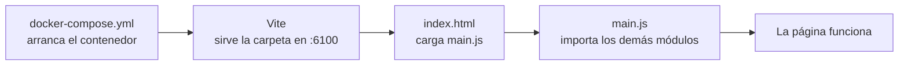

# UD 3.2 · Batería de repaso con comprobador (UD1 → UD3)

Una batería de ejercicios **paso a paso** para repasar todo lo dado hasta la UD3: el entorno
(Vite, Docker, Git, ESLint), depurar en el navegador, tipos, funciones, closures, control de flujo
y arrays. A diferencia de la [3.1](ud03-1-ejercicios.md), aquí trabajas en un proyecto de verdad
y un **comprobador automático** te dice qué tienes bien, qué falla y por qué.

| | |
|---|---|
| **Para qué** | Repasar UD1–UD3 a tu ritmo, con corrección automática |
| **Tiempo** | Unas **10 horas** en total. Puedes hacerlo por bloques, en el orden de la tabla de abajo |
| **Material** | El kit: [⬇️ kit-dwec-repaso-ud1-ud3.zip](../assets/descargas/kit-dwec-repaso-ud1-ud3.zip) |
| **No es una práctica evaluable** | No se entrega (salvo que tu profesor te lo pida) |

[:material-download: Descargar el kit](../assets/descargas/kit-dwec-repaso-ud1-ud3.zip){ .md-button .md-button--primary }
[:material-format-list-numbered: Batería 3.1 (sin kit)](ud03-1-ejercicios.md){ .md-button }

## 🎯 Cómo funciona

No tienes que construir un programa entero. Vas a ir **bloque a bloque**, y en cada uno siempre
pasa lo mismo:

| | |
|---|---|
| 📖 **Lo que tienes que saber** | La idea en pocas líneas, con código |
| 🔮 **¿Qué da?** | Escribes lo que crees que da un trozo de código **antes** de probarlo. Luego el comprobador te explica el porqué |
| 👀 **Ejemplo** | Un ejercicio ya resuelto en el propio fichero. Léelo bien: los tuyos se parecen |
| 🪜 **Escalera** | 2–4 ejercicios muy cortos, de uno en uno, para coger el concepto antes de los de verdad |
| ✍️ **Tu turno** | Funciones cortas que escribes tú, ya combinando cosas |
| ✅ **Cómo sabes que está bien** | `./refuerzo.sh comprobar N` te dice qué está bien y qué falla |

El comprobador **no te da la solución**: te dice qué caso falla y qué ha salido. Por ejemplo:

```text
  ✘ 1.1   formatearEuros
         formatearEuros(5) debería dar '5,00 €' y da '5.00 €'
```

Con las predicciones, cuando compruebas **un solo bloque** (`./refuerzo.sh comprobar 1`), te explica
el **porqué** de las que aciertas y te da una **pista** (no la respuesta) de las que fallas:

```text
  ✔ p2 · "5" * 3  → 15: *, - y / no existen para textos, así que convierten a número
  ✘ p5 · NaN ?? 1  → no es 1. Pista: ?? no mira si es falsy: solo si es null o undefined
```

!!! tip "Para estudiar"
    Lee **todas** las explicaciones, también las de las que aciertas: a veces se acierta por
    intuición sin saber por qué. Cuando todo un bloque esté en verde, intenta explicar cada
    predicción en voz alta sin mirar.

!!! warning "Sin IA y sin copiar"
    Esto es para que **aprendas**. Si te lo resuelve una IA o lo copias, el comprobador saldrá en
    verde pero no habrás aprendido nada. Si te atascas, usa las **pistas** (están plegadas: ábrelas
    solo cuando las necesites) y los apuntes de [UD2](ud02.md) y [UD3](ud03.md).

### Orden y tiempo orientativo

| Bloque | Qué | Tiempo |
|---|---|---|
| **0** | El entorno paso a paso: Docker, Vite, Git, módulos y ESLint | 45 min |
| **D** | Depurar en el navegador con breakpoints (5 bugs) | 1 h 15 min |
| **1** | Tipos, conversiones y operadores (`\|\|`, `??`, `?.`) | 1 h |
| **2** | Funciones: las 3 formas, por defecto, *rest*, HOF | 1 h 15 min |
| **3** | Closures | 1 h 15 min |
| **4** | Control de flujo: `if`, `switch`, bucles | 1 h |
| **5** | Arrays e inmutabilidad: `map`, `filter`, `find`, `reduce`, `sort`, spread | 2 h |
| **6** | Integrador: una venta de RetroStock completa | 45 min |
| ✍️ | `respuestas.md`: explícalo con tus palabras | 30 min |

Hazlos **en orden**: cada bloque usa funciones de los anteriores. Al terminar cada uno, haz un
commit (paso 0.2).

---

## 📦 Antes de empezar

### Lo que necesitas

- **Docker** funcionando (el mismo que usaste en la práctica 1). Compruébalo: `docker info` no
  debe dar error.
- **Git**, **VS Code** y **Chrome** (o Firefox).
- **Internet** solo la primera vez (para construir la imagen).
- En **Windows**: abre la terminal **Git Bash** o **WSL** (las órdenes son de Linux).

??? tip "Plan B: no tengo Docker en casa"
    Si tienes **Node 20 o más nuevo** (`node --version`), el kit funciona sin Docker:
    `./refuerzo.sh arrancar` usa tu Node (necesita internet la primera vez para descargar Vite) y
    `./refuerzo.sh comprobar` funciona igual. Lo único que no tendrás es ESLint (paso 0.6): esas
    comprobaciones salen con un `!` amarillo y las revisamos en clase. El paso 0.3 (Docker
    Compose) **hazlo igualmente**: el comprobador revisa el fichero.

### Descomprimir y preparar

```bash
unzip kit-dwec-repaso-ud1-ud3.zip      # descomprime el kit
cd dwec-refuerzo-p1                 # entra en su carpeta
chmod +x refuerzo.sh                # da permiso de ejecución al script
./refuerzo.sh preparar              # tu nombre + construir la imagen (unos minutos)
code .                              # abre la carpeta en VS Code
```

### Las órdenes del kit

Todas se escriben **en la terminal, dentro de la carpeta `dwec-refuerzo-p1`**:

| Orden | Para qué |
|---|---|
| `./refuerzo.sh preparar` | (1 vez) Tu nombre y construir la imagen |
| `./refuerzo.sh arrancar` | Arrancar Vite → http://localhost:6100 |
| `./refuerzo.sh comprobar` | Ver qué llevas bien y qué te falta (todo) |
| `./refuerzo.sh comprobar 3` | Solo un bloque: `0`, `d`, `1`, `2`, `3`, `4`, `5`, `6`, `final` |
| `./refuerzo.sh lint` | Pasar ESLint a todo `src/` |
| `./refuerzo.sh logs` | Ver los mensajes de Vite (Ctrl+C para salir) |
| `./refuerzo.sh parar` | Parar Vite al terminar (no se pierde nada) |
| `./refuerzo.sh entregar` | Generar el `.zip` de la entrega en `entrega/` |

### Qué hay en el kit

```text
dwec-refuerzo-p1/
├── refuerzo.sh            ← el mando: todas las órdenes
├── docker-compose.yml     ← ✍️ paso 0.3
├── Dockerfile             ← la imagen (Node + Vite + ESLint + Git). No hace falta tocarlo
├── index.html             ← ✍️ paso 0.4
├── depuracion.md          ← ✍️ bloque D: tu informe de depuración
├── respuestas.md          ← ✍️ al final: explícalo con tus palabras
├── src/
│   ├── main.js            ← ✍️ paso 0.5
│   ├── bloque0/           ← ✍️ pasos 0.5 y 0.6
│   ├── depuracion/        ← ✍️ bloque D: caja.js tiene los bugs
│   ├── bloque1/ … bloque6/  ← ✍️ predicciones.js + los ejercicios de cada bloque
│   └── pagina/            ← estilos (no se tocan)
└── comprobador/           ← las pruebas (puedes leerlas, no las cambies)
```

---

## BLOQUE 0 · El entorno paso a paso

En la práctica 1, a varios no os arrancaba el proyecto. Aquí lo montamos **pieza a pieza** para que
sepas qué hace cada una y, sobre todo, **qué mirar cuando no funciona**.



### 0.1 · Comprobar las herramientas

✍️ **Tu turno.** Ejecuta y comprueba que ninguna da error:

```bash
docker --version          # Docker version 2x.x…
docker compose version    # Docker Compose version v2…
git --version             # git version 2.x
./refuerzo.sh ayuda       # la lista de órdenes; abajo dice «Modo: docker»
```

??? tip "Si algo falla"
    - `permission denied` con Docker en Linux: `sudo usermod -aG docker $USER` y **cierra sesión**.
    - `Cannot connect to the Docker daemon`: Docker no está arrancado (`sudo systemctl start docker`
      o abre Docker Desktop).
    - `refuerzo.sh: Permission denied`: te falta `chmod +x refuerzo.sh`.

### 0.2 · Git: tu historial

📖 **Lo que tienes que saber.** Git guarda «fotos» (commits) de tu carpeta. Un buen historial cuenta
cómo has trabajado. El ciclo es siempre el mismo: **cambias → `git add` →
`git commit -m "qué has hecho"`**.

👀 **Ejemplo** (hazlo tal cual, con tus datos):

```bash
git init                                       # convierte la carpeta en un repositorio
git config user.name "Tu Nombre Apellido"      # quién firma los commits
git config user.email "tu-correo@ejemplo.com"
git add .                                      # prepara TODOS los ficheros
git commit -m "Kit inicial del refuerzo"       # primera foto
git log --oneline                              # ves tu commit
```

✍️ **Tu turno.** A partir de ahora, **al terminar cada bloque** haz un commit con un mensaje que
diga qué has hecho, por ejemplo `git commit -m "Bloque 0: entorno montado"`. Se piden al
menos **8 commits** al final.

✅ `./refuerzo.sh comprobar 0` → **0.2** en verde.

### 0.3 · Docker Compose: el servidor de Vite

📖 **Lo que tienes que saber.** Un **servicio** de `docker-compose.yml` es «una máquina» que Docker
arranca a partir de una imagen. Lo que necesitas saber de cada línea:

| Clave | Qué hace |
|---|---|
| `image` | De qué imagen sale el contenedor |
| `volumes` | Qué carpeta de **tu PC** se ve dentro del contenedor: `CARPETA_PC:CARPETA_CONTENEDOR` |
| `working_dir` | En qué carpeta del contenedor se ejecuta la orden |
| `ports` | Qué puerto de **tu PC** lleva a qué puerto del contenedor: `PUERTO_PC:PUERTO_CONTENEDOR` |
| `command` | La orden que ejecuta el contenedor al arrancar |

👀 **Ejemplo.** Abre `docker-compose.yml`: el servicio `comprobador` está completo y comentado
(es el que usa `./refuerzo.sh comprobar`).

✍️ **Tu turno.** Completa los tres `____` del servicio `web`:

1. `volumes`: tu carpeta del kit (`.`) montada en `/app`, igual que en el ejemplo.
2. `ports`: en tu PC abrirás el **6100**; Vite escucha dentro del contenedor en el **5173**.
3. `command`: Vite tiene que escuchar en **todas las direcciones** del contenedor (`0.0.0.0`); si
   no, solo se le podría llamar desde dentro y tu navegador no llegaría.

Después:

```bash
./refuerzo.sh arrancar        # → ✔ Vite arrancado: abre http://localhost:6100
```

??? tip "Pista"
    En YAML **los espacios importan**: el `-` de cada lista va 6 espacios a la derecha, debajo de la
    clave. Si `arrancar` dice que hay un error, ejecuta `docker compose config` y lee la línea que
    indica. El puerto va entre comillas: `"127.0.0.1:____:____"` → primero el de tu PC.

✅ La página abre (todavía dice «tu JavaScript todavía no se está cargando»: es normal) y
`./refuerzo.sh comprobar 0` → **0.3** en verde.

### 0.4 · `index.html` carga tu JavaScript

📖 **Lo que tienes que saber.** El navegador solo ejecuta el JavaScript que el HTML le dice. Como
usamos `import`/`export`, el fichero se carga como **módulo**: `<script type="module" …>`. Sin
`type="module"`, el primer `import` da `SyntaxError: Cannot use import statement outside a module`.

👀 **Ejemplo.** En `index.html`, la hoja de estilos ya está enlazada:
`<link rel="stylesheet" href="/src/pagina/estilos.css" />`. La ruta empieza en la carpeta del kit.

✍️ **Tu turno.** Donde dice `TU TURNO (paso 0.4)`, añade la etiqueta `<script>` que carga
`/src/main.js` como módulo. Guarda: Vite recarga la página solo.

✅ En la página aparece el **Bloque D** con sus botones, y arriba «Página cargada el…». Además,
`./refuerzo.sh comprobar 0` → **0.4** en verde.

### 0.5 · Módulos: `export` e `import`

📖 **Lo que tienes que saber.** Cada fichero `.js` es un **módulo** con sus propias variables. Para
usar una función de otro fichero, el que la tiene la **exporta** y el que la usa la **importa**:

```js
// fecha.js                                   // main.js
export function fechaDeHoy() { … }            import { fechaDeHoy } from "./bloque0/fecha.js";
```

Los errores que vimos en la práctica 1 (todos hacen que la página se quede sin JavaScript):

| Error | Qué ves |
|---|---|
| Falta el `export` | Consola (F12): `does not provide an export named 'saludar'` |
| Ruta sin `./` (`"bloque0/saludo.js"`) | Vite da un error 500 y te enseña en qué fichero y línea |
| Ruta con comillas invertidas `` `./bloque0/saludo.js` `` | Igual: error 500 de Vite. En un `import`, la ruta va entre comillas normales |
| Ruta sin `.js` | Vite lo arregla solo, pero **ponlo siempre**: sin Vite (o en otro proyecto) falla |
| `<script>` sin `type="module"` | Consola: `Cannot use import statement outside a module` |

👀 **Ejemplo.** `src/bloque0/fecha.js` y la línea de `import` de `fechaDeHoy` en `src/main.js`.

✍️ **Tu turno.**

1. En `src/bloque0/saludo.js`: exporta `saludar` y haz que devuelva
   `` `Hola, ${nombre}. ¡El entorno funciona!` ``.
2. En `src/main.js`: impórtala y cambia la línea del saludo para que use `saludar("Tu Nombre")`.

✅ La cabecera de la página dice «Hola, Tu Nombre. ¡El entorno funciona!». **Abre la consola (F12 →
Consola)**: no debe haber nada en rojo. `./refuerzo.sh comprobar 0` → **0.5** en verde.

### 0.6 · ESLint: el corrector

📖 **Lo que tienes que saber.** ESLint lee tu código y avisa de lo que está mal o es peligroso,
**sin ejecutarlo**. Las reglas del kit (las mismas que pedía la práctica 1):

| Regla | Qué prohíbe |
|---|---|
| `no-var` | `var` (usa `let` o `const`) |
| `prefer-const` | `let` en una variable que nunca se reasigna (usa `const`) |
| `eqeqeq` | `==` y `!=` (usa `===` y `!==`) |
| `no-unused-vars` | Variables que se declaran y no se usan |
| `no-console` (aviso) | `console.log` olvidados |

👀 **Ejemplo.** Cómo se lee un error:

```text
/app/src/bloque0/errores-lint.js
  6:3  error  Unexpected var, use let or const instead  no-var
  ↑ ↑                                                   ↑
línea columna            qué pasa                      la regla
```

✍️ **Tu turno.** `./refuerzo.sh lint src/bloque0/errores-lint.js` da 4 errores. Arréglalos uno a
uno **sin cambiar lo que hace la función** (contar los productos con stock 0).

✅ `./refuerzo.sh lint src/bloque0/errores-lint.js` → «sin errores» y **0.6** en verde.

!!! note "¿Y los errores del resto de `src/`?"
    `./refuerzo.sh lint` (sin fichero) también se queja de `import` que «no se usan» en los
    bloques que aún no has hecho. Es normal: desaparecen cuando escribes las funciones.

**Commit:** `git add . && git commit -m "Bloque 0: entorno montado"`

---

## BLOQUE D · Depurar en el navegador

📖 **Lo que tienes que saber.** Un **breakpoint** para el programa en una línea y te deja ver
**todas** las variables en ese momento, sin escribir nada. Luego avanzas línea a línea y ves cómo
cambian. Es mucho más rápido que llenar el código de `console.log` (que además hay que borrar).

### D.1 · Las DevTools en 5 minutos

Abre http://localhost:6100 y pulsa **F12**. Ve a la pestaña **Fuentes** (*Sources*; en Firefox,
**Depurador**).

| Quieres… | Cómo |
|---|---|
| Abrir un fichero | **Ctrl+P** y escribe `caja.js` |
| Poner un breakpoint | Clic en el **número de línea** (sale una marca azul). Otro clic lo quita |
| Breakpoint condicional | Clic derecho en el número → *Añadir punto de interrupción condicional* → escribe p. ej. `unidades === 4` |
| Ver las variables | Panel **Ámbito** (*Scope*) a la derecha, en *Local* |
| Vigilar una expresión | Panel **Watch** (en español, *Observar* o *Inspección*) → `+` → escribe `lineas[i]` o `productos === PRODUCTOS` |
| Seguir hasta el siguiente breakpoint | **F8** (▶) |
| Ejecutar la línea y pararse en la siguiente | **F10** (*paso por encima*) |
| Entrar dentro de la función que se llama | **F11** |
| Salir de la función actual | **Mayús+F11** |
| Ver el valor de algo en un momento | Pasa el ratón por encima de la variable en el código |

!!! tip "La consola también vale mientras está parado"
    Con el programa parado, en la pestaña **Consola** puedes escribir `linea`, `total`,
    `lineas.length`… y te da el valor **en ese momento**. Es la forma rápida de comprobar una idea.

### D.2 · 👀 Ejemplo resuelto: el total del ticket

**Síntoma.** En la página, «Calcular el total» da **85 €** y debería dar **105 €**.

Sigue estos pasos **tú** (con el ratón, no solo leyendo):

1. F12 → Fuentes → Ctrl+P → `caja.js`.
2. Clic en el número de la línea **17** (`const linea = lineas[i];`).
3. En la página, pulsa «Calcular el total». El programa **se para** en la línea 17.
4. Mira **Ámbito → Local**: `i = 1`. Despliega `lineas`: tiene 3 elementos (0, 1 y 2).
5. Pulsa **F10**: ahora `linea` es el **Zelda**… ¿y el Tetris, que está en la posición 0?
6. Pulsa **F8** dos veces: la siguiente parada es con `i = 2` y luego termina. **Nunca ha pasado por `i = 0`.**
7. Conclusión: el bucle empieza en 1 y los arrays empiezan en 0 → **20 € del Tetris sin sumar**
   (105 − 20 = 85 ✔).
8. Arreglo: `for (let i = 0; …)`. Guarda, quita el breakpoint y vuelve a pulsar: **105,00 €**.

Así está escrita la ficha del ejemplo en `depuracion.md`: síntoma, dónde pusiste el breakpoint,
**qué viste** (con los valores), por qué falla y el arreglo.

### D.3 · ✍️ Tu turno: 4 bugs

Para cada uno: **reprodúcelo** en la página, **para** el programa con un breakpoint en la función
que toca, **mira** las variables hasta entender qué pasa, **arréglalo** en `caja.js` y **rellena su
ficha** en `depuracion.md`. Nada de `console.log`.

| Bug | Botón | Lo que debería pasar |
|---|---|---|
| **1** | Añadir unidades de Zelda | Hay 2. Si escribes 3, debe haber 5. Si escribes «hola» o cancelas, siguen 2 |
| **2** | Ver el stock | Sonic 2 tiene stock 0: debe salir **0**. Pokémon Rojo no tiene el dato: «sin datos» |
| **3** | Ordenar por precio → Ver el catálogo original | El original sigue en su orden: Tetris, Zelda, Sonic, Crash, Pokémon |
| **4** | Precio de 4 Crash / de 3 Crash | 4 unidades → 10 %: **22,50 €**. 3 unidades → 5 %: **23,75 €** |

??? tip "Pista del bug 1"
    Breakpoint dentro de `sumarUnidades`. En *Ámbito*, fíjate en **cómo** se muestran `actuales` y
    `textoDelUsuario`: ¿los dos son números? (un texto sale entre comillas). ¿Qué devuelve siempre
    `prompt`? Para lo de «hola»: haz la predicción `Number("hola")` en la consola.

??? tip "Pista del bug 2"
    Breakpoint condicional en `stockTexto` con la condición `producto.titulo === "Sonic 2"`. ¿Cuánto
    vale `producto.stock`? ¿Y `stock` después de esa línea? Repasa la tabla de `||` y `??` del bloque 1.

??? tip "Pista del bug 3"
    Pulsa «Ordenar» con un breakpoint en `ordenarPorPrecio`. En **Watch** añade
    `productos === PRODUCTOS` y, después de la línea del `sort`, `ordenados === productos`.
    Si los dos son `true`… ¿cuántos arrays hay en realidad?

??? tip "Pista del bug 4"
    Breakpoint condicional con `unidades === 4` y avanza con **F10** línea a línea: ¿entra en el
    primer `if` o salta al `else if`? Calcula a mano `4 > 4`.

✅ `./refuerzo.sh comprobar d` → los 4 bugs, el ejemplo y `depuracion.md` en verde. Antes de
entregar: **quita todos los breakpoints** y cualquier `debugger;` que hayas escrito.

!!! info "La palabra `debugger;`"
    Si escribes `debugger;` en una línea de tu código, el navegador se para ahí cuando las DevTools
    están abiertas: es un breakpoint escrito en el código. Útil cuando no encuentras la línea en
    Fuentes. **Bórralo** al terminar (ESLint te avisa).

**Commit:** `git commit -am "Bloque D: 4 bugs depurados"`

---

## BLOQUE 1 · Tipos, conversiones y operadores

Ficheros: `src/bloque1/predicciones.js` y `src/bloque1/tipos.js`.

📖 **Lo que tienes que saber.**

| Expresión | Da | Por qué |
|---|---|---|
| `"5" + 3` | `"53"` | Con un texto, `+` **concatena** |
| `"5" * 3` | `15` | `*`, `-`, `/` convierten a número |
| `Number("12.5")` · `Number("12,5")` | `12.5` · `NaN` | La coma no es decimal en JS |
| `"5" === 5` | `false` | `===` compara también el tipo (por eso nunca `==`) |
| `a \|\| b` | `b` si `a` es *falsy* | Falsy: `0`, `""`, `false`, `null`, `undefined`, `NaN` |
| `a ?? b` | `b` solo si `a` es `null` o `undefined` | El `0` y el `""` **sí** son valores |
| `obj?.prop` | `undefined` si `obj` no existe | En vez de romper con `TypeError` |
| `n.toFixed(2)` | un **texto** | `(5).toFixed(2)` → `"5.00"` |

**Regla de oro:** si el `0` (o el `""`) es un dato válido, usa `??`. Si un valor vacío no
te vale, `||`.

🔮 **¿Qué da?** Abre `predicciones.js`, escribe tus 10 respuestas **sin probar nada** y luego
`./refuerzo.sh comprobar 1`. Las que falles, pruébalas en la consola del navegador y **piensa por
qué** antes de corregirlas. Apunta en un papel las que no entiendas: es tu lista de estudio.

👀 **Ejemplos** en `tipos.js`: `redondear` (lo usarás en todos los bloques) y `formatearUnidades`
(ternario + plantilla).

🪜 **Escalera** (en `tipos.js`, antes de los ejercicios):

| # | Función | Concepto |
|---|---|---|
| 1.a | `esTexto(valor)` | `typeof` |
| 1.b | `sumarTextos(a, b)` → `"3"` y `"4"` dan `7` | Convertir antes de sumar |
| 1.c | `valorODefecto(valor, defecto)` | `??` (el `0` y el `""` son valores) |

✍️ **Tu turno** (en `tipos.js`; cada función trae sus ejemplos de entrada y salida en el comentario):

| # | Función | Practica |
|---|---|---|
| 1.1 | `formatearEuros(numero)` → `"42,75 €"` | `toFixed`, `replace`, plantillas |
| 1.2 | `aNumero(texto)` → número o `null` | Lo que devuelve `prompt`, `Number`, `NaN` |
| 1.3 | `stockVisible(producto)` | `?.` y `??` con el `0` |
| 1.4 | `nombreCorto(producto)` | Cuándo `\|\|` y cuándo `??` |

??? tip "Pista de 1.2"
    Por orden: si `texto` es `null` o, quitando espacios, es `""`, devuelve `null`. Si no, quita
    espacios, cambia la coma por punto y conviértelo con `Number`. Si sale `NaN`, `null`.
    ⚠️ `NaN === NaN` es `false`: para saber si algo es `NaN` se usa `Number.isNaN(x)`.

??? tip "Pista de 1.4"
    El título vacío **no** vale (→ `||`), pero la plataforma solo se sustituye si **no viene** (→ `??`).

✅ `./refuerzo.sh comprobar 1` → todo en verde. **Commit.**

---

## BLOQUE 2 · Funciones

Ficheros: `src/bloque2/predicciones.js` y `src/bloque2/funciones.js`.

📖 **Lo que tienes que saber.**

```js
// 1 · Declarada: se puede llamar ANTES de la línea donde está (hoisting)
function precioConEstado(base, estado = "usado-como-nuevo") { … }

// 2 · Expresión de función: es una variable; no existe hasta que se ejecuta esta línea
const precioFinal = function (base, estado, unidades = 1) { … };

// 3 · Arrow: corta. Con una sola expresión, el return es implícito
const doble = (n) => n * 2;
const crear = (titulo) => ({ titulo });    // ⚠️ un objeto va entre PARÉNTESIS
                                           //    sin ellos, { } es un bloque y devuelve undefined
```

| Concepto | Ejemplo | Qué pasa |
|---|---|---|
| Parámetro por defecto | `(a, b = 2) => a * b` | `f(3)` y `f(3, undefined)` usan el 2; `f(3, null)` **no** (null es un valor) |
| *Rest* | `(...numeros) => …` | Junta todos los argumentos en **un array** (`[]` si no hay ninguno) |
| *Spread* | `Math.max(...[4, 9, 2])` | Separa el array en argumentos sueltos |
| HOF | `contarSi(lista, condicion)` | Una función que **recibe** (o devuelve) otra función |

🔮 **¿Qué da?** `predicciones.js` (9). Mismo método que en el bloque 1.

👀 **Ejemplos** en `funciones.js`: `precioConEstado` (declarada + por defecto, Tabla A de la P1) y
`contarSi` (una HOF que cuenta los que cumplen una condición sin usar `.filter()`, escrita a mano
para que veas cómo funcionan por dentro los métodos de array).

🪜 **Escalera:**

| # | Función | Concepto |
|---|---|---|
| 2.a | `triple(n)` | Función **declarada** |
| 2.b | `esPar(n)` | **Arrow** de una línea, sin llaves ni `return` |
| 2.c | `saludar(nombre)` → `"Hola, invitado"` si no viene | Parámetro **por defecto** |

✍️ **Tu turno:**

| # | Función | Practica |
|---|---|---|
| 2.1 | `descuentoVolumen(unidades)` | Tabla B, función **declarada**, los límites (`>=`) |
| 2.2 | `precioFinal(base, estado, unidades)` | **Expresión** de función, por defecto, reutilizar funciones |
| 2.3 | `crearProducto(id, titulo, precio, stock)` | **Arrow** que devuelve un objeto, por defecto |
| 2.4 | `sumarImportes(...importes)` | Parámetro ***rest*** + `for...of` |
| 2.5 | `buscarCon(lista, condicion)` | HOF: tu propio `.find()` **sin usar `.find()`** |

??? tip "Pista de 2.2"
    No repitas las tablas: primero `precioConEstado(base, estado)` y luego multiplica por
    `(1 - descuentoVolumen(unidades))`. Redondea al final. Comprueba a mano el caso 1:
    45 × 1 × 0,95 = 42,75.

??? tip "Pista de 2.5"
    Copia la estructura de `contarSi`. La diferencia: en vez de contar, en cuanto un elemento cumple
    la condición lo **devuelves** (`return elemento` dentro del bucle). Si el bucle termina sin
    encontrar ninguno, `return null`.

✅ `./refuerzo.sh comprobar 2` → todo en verde. **Commit.**

---

## BLOQUE 3 · Closures

Ficheros: `src/bloque3/predicciones.js` y `src/bloque3/closures.js`.

📖 **Lo que tienes que saber.** Una **closure** es una función que «recuerda» las variables de la
función donde se creó, aunque esa función ya haya terminado. Sirve para tener **datos privados**:

```js
function crearMarcador() {
  let puntos = 0;                    // ← privada: solo la ven las funciones de abajo
  return {
    anotar(cantidad) { puntos += cantidad; },
    puntos() { return puntos; },
  };
}
const m1 = crearMarcador();          // cada llamada crea SUS PROPIOS «puntos»
const m2 = crearMarcador();
m1.anotar(10);
m1.puntos();   // 10
m2.puntos();   // 0  ← no se mezclan
```

Desde fuera solo se puede usar lo que devuelve el `return`: no hay forma de llegar a la variable
`puntos` y cambiarla a mano.

Y si devuelves un array privado, devuelve una **copia** (`[...lista]`): si no, desde fuera pueden
hacer `push` en tu array.

Tres formas de closure, de menos a más:

| Devuelve… | Ejemplo |
|---|---|
| **una** función | `crearDescuento(20)` → `(precio) => …` |
| un **objeto** de funciones | `crearListaDeseos()` → `{ anadir, quitar, … }` |
| una función que recuerda un estado que **cambia** | `crearGeneradorId(13)` → 13, 14, 15… |

🔮 **¿Qué da?** `predicciones.js` (7), sobre el `crearMarcador` del ejemplo.

👀 **Ejemplo** en `closures.js`: `crearMarcador`, con `jugadas` privadas que se devuelven copiadas.

🪜 **Escalera:**

| # | Función | Concepto |
|---|---|---|
| 3.a | `crearMultiplicador(factor)` | Devolver **una** función que recuerda `factor` |
| 3.b | `crearPasos(paso)` → `{ avanzar, posicion }` | Un **objeto** con dos funciones que comparten una variable que cambia |

✍️ **Tu turno:**

| # | Función | Practica |
|---|---|---|
| 3.1 | `crearDescuento(porcentaje)` | Función que devuelve una función |
| 3.2 | `crearListaDeseos()` | Objeto de funciones con estado privado, *rest*, copia defensiva |
| 3.3 | `crearGeneradorId(inicial)` | Estado que cambia en cada llamada, por defecto |

??? tip "Pista de 3.2"
    Copia la forma del marcador: un `let titulos = []` dentro y un `return { … }` con 4 funciones.
    `anadir(...nuevos)`: recorre `nuevos` con `for...of` y añade (sin `push`:
    `titulos = [...titulos, t]`) solo los que sean texto, no vacíos y que no estén ya
    (`titulos.includes(t)`), contando cuántos añades. `quitar`: si no está, `false`; si está,
    `titulos = titulos.filter(...)` y `true`.

??? tip "Pista de 3.3"
    `let siguiente = inicial;` y devuelve una arrow que hace `return siguiente++`. Ojo: `x++`
    devuelve el valor **de antes** de sumar. Pruébalo en la consola.

✅ `./refuerzo.sh comprobar 3` → todo en verde. **Commit.**

---

## BLOQUE 4 · Control de flujo

Ficheros: `src/bloque4/predicciones.js` y `src/bloque4/control.js`.

📖 **Lo que tienes que saber.**

| Herramienta | Cuándo |
|---|---|
| Ternario `c ? a : b` | Una decisión simple con **dos** caminos que devuelve un valor |
| `if / else if / else` | Varios caminos o condiciones con rangos (`< 3`, `>= 4`…) |
| `switch` | Comparar **un** valor con varios valores exactos. **Cada `case` necesita `break` (o `return`)**: si no, sigue ejecutando el siguiente |
| `while` | Repetir mientras se cumpla algo (un menú). ¡Que la condición acabe siendo falsa! |
| `for (let i = …)` | Repetir un número conocido de veces |
| `for...of` | Recorrer los **valores** de un array |
| `for...in` | Recorre las **claves** (en un array: `"0"`, `"1"`… como texto). No lo uses con arrays |

🔮 **¿Qué da?** `predicciones.js` (7). La primera es la trampa del `switch` sin `break`.

👀 **Ejemplo** en `control.js`: `procesarSemaforo(colores)`. Es **el mismo esquema que el menú de
la práctica 1** (bucle + `switch`), pero en vez de `prompt` recibe un array con lo que el usuario
teclearía. Así se puede probar automáticamente. Fíjate en los dos `case` seguidos y en cómo
«apagar» termina el bucle.

🪜 **Escalera:**

| # | Función | Concepto |
|---|---|---|
| 4.a | `signo(numero)` → `"positivo"` / `"negativo"` / `"cero"` | `if / else if / else` |
| 4.b | `sumarHasta(n)` → 1 + 2 + … + n | `for` con acumulador |
| 4.c | `contarVocales(texto)` | `for...of` sobre un texto, letra a letra |

✍️ **Tu turno:**

| # | Función | Practica |
|---|---|---|
| 4.1 | `clasificarStock(stock)` | `if / else if / else`, validar el tipo |
| 4.2 | `nombreEstado(estado)` | `switch` con `default` |
| 4.3 | `simularMenu(entradas)` | El menú de RetroStock: bucle + `switch` + salir |
| 4.4 | `tablaDescuentos(maxUnidades)` | `for` y funciones **importadas** de otros bloques |

??? tip "Pista de 4.3"
    Copia `procesarSemaforo` y cambia los `case`. Lo de «Fin sin salir»: después del bucle, si
    **todavía** se seguía (no se pulsó el 6), añádelo. Si el comprobador dice «no termina nunca»,
    te falta avanzar el índice (`i++`).

??? tip "Pista de 4.4"
    `for (let u = 1; u <= maxUnidades; u++)` y en cada vuelta mete en el array
    `` `${formatearUnidades(u)} → ${Math.round(descuentoVolumen(u) * 100)} %` ``.

✅ `./refuerzo.sh comprobar 4` → todo en verde. **Commit.**

---

## BLOQUE 5 · Arrays e inmutabilidad

Ficheros: `src/bloque5/predicciones.js`, `src/bloque5/arrays.js` y `src/bloque5/datos.js` (el
catálogo de prueba, no se toca).

📖 **Lo que tienes que saber.**

| Método | Devuelve | Para |
|---|---|---|
| `map(fn)` | Array **del mismo tamaño**, transformado | Formatear, cambiar un elemento |
| `filter(fn)` | Array con los que cumplen (puede ser `[]`) | Filtrar |
| `find(fn)` | **El primero** que cumple, o `undefined` | Buscar uno |
| `some(fn)` / `every(fn)` | `true`/`false`: ¿alguno? / ¿todos? | Avisos, validar |
| `reduce((acc, x) => …, inicial)` | **Un** valor | Sumar, el máximo, un resumen. **Siempre con valor inicial** |
| `sort((a, b) => a.precio - b.precio)` | ⚠️ **El mismo array**, ordenado | Ordenar. Sin comparador ordena como texto: `[10, 9, 1]` → `[1, 10, 9]` |

**Inmutabilidad.** Un array guardado en una variable es una **referencia**: `const b = a` **no**
copia, son el mismo array. `const` solo impide reasignar la variable, no cambiar su contenido.
Para no mutar:

```js
const copia = [...lista];                                   // copiar un array
const ordenada = [...lista].sort((a, b) => a.precio - b.precio);   // ordenar sin mutar
const nuevo = lista.map((p) => (p.id === id ? { ...p, stock: p.stock - 1 } : p));  // cambiar uno
```

**Destructuring:** `const { titulo, stock = 0 } = producto;` y también en parámetros:
`.map(({ titulo, precio }) => …)`.

!!! warning "El catálogo de `datos.js` está congelado"
    Tiene `Object.freeze`: si tu código lo modifica (`push`, `sort`, `p.stock = …`), salta un
    `TypeError` y el comprobador te dice «Estás MODIFICANDO el catálogo original». Es justo lo que
    hay que evitar siempre.

🔮 **¿Qué da?** `predicciones.js` (10).

👀 **Ejemplos** en `arrays.js`: `titulos` (`map`), `deCategoria` (`filter`) y `reponer`
(inmutabilidad: `map` + spread). El 5.7 se parece mucho a `reponer`.

🪜 **Escalera** (con arrays de números, un método cada vez):

| # | Función | Concepto |
|---|---|---|
| 5.a | `dobles(numeros)` | `map` |
| 5.b | `mayoresQue(numeros, limite)` | `filter` |
| 5.c | `sumaTotal(numeros)` | `reduce` con valor inicial |
| 5.d | `anadirAlFinal(lista, elemento)` | Spread, sin `push` |

✍️ **Tu turno:**

| # | Función | Practica |
|---|---|---|
| 5.1 | `buscarPorId(catalogo, id)` | `find` + `??` |
| 5.2 | `buscarPorTitulo(catalogo, texto)` | `filter`, `toLowerCase`, `includes` |
| 5.3 | `valorStock(catalogo)` | `reduce` con valor inicial |
| 5.4 | `ordenarPorPrecio(catalogo)` | `sort` con comparador **sin mutar** |
| 5.5 | `hayStockBajo(catalogo)` | `some` |
| 5.6 | `lineasCatalogo(catalogo)` | `filter` + `map` encadenados, destructuring, ternario |
| 5.7 | `vender(catalogo, id, unidades)` | Inmutabilidad: `map` + spread, por defecto |
| 5.8 | `resumenVentas(ventas)` | `reduce` + destructuring, lista vacía |

??? tip "Pista de 5.7"
    Primero busca el producto con `find`. Si no existe o `producto.stock < unidades`, devuelve
    `catalogo` tal cual. Si no, haz lo mismo que `reponer` pero restando.

??? tip "Pista de 5.8"
    Dos `reduce`: uno suma `total` (empieza en 0). El otro busca la venta con más unidades: empieza
    en `null` y en cada vuelta se queda con la venta actual si `max === null` o si tiene más unidades
    que `max`. Al final, `masVendido` es su `titulo` (o `null`: `?.` y `??`).

✅ `./refuerzo.sh comprobar 5` → todo en verde. **Commit.**

---

## BLOQUE 6 · Integrador: una venta completa

Fichero: `src/bloque6/tienda.js`.

📖 **Lo que tienes que saber.** No hay nada nuevo: hay que **juntar** lo que ya tienes
(`buscarPorId`, `precioFinal`, `vender`, `redondear`, `formatearEuros`…). Es la opción «Registrar
venta» de la práctica 1, que a muchos no os salía, y los **casos 1 y 2** de la práctica tienen que
dar exactamente:

| Caso | Producto | Venta | Precio unitario | Total | Stock final |
|---|---|---|---|---|---|
| 1 | Chrono Trigger · 45 € · `usado-como-nuevo` · stock 4 | 3 uds. | 42,75 € | 128,25 € | 1 |
| 2 | Streets of Rage 2 · 60 € · `nuevo-precintado` · stock 10 | 4 uds. | 67,50 € | 270,00 € | 6 |

✍️ **Tu turno:**

| # | Función | Practica |
|---|---|---|
| 6.1 | `registrarVenta(catalogo, id, unidades)` → `{ catalogo, venta }` o `{ catalogo, error }` | Validar en orden, reutilizar, no mutar |
| 6.2 | `ticket(venta)` → `"Chrono Trigger · 3 uds. × 42,75 € = 128,25 €"` | Destructuring de un objeto, plantillas |

??? tip "Pista de 6.1"
    Tres `if` con `return` temprano para los errores (en el orden del comentario) y, al final, la
    venta buena: `precioUnitario = precioFinal(…)`, `total = redondear(precioUnitario * unidades)` y
    `catalogo: vender(catalogo, id, unidades)`. `Number.isInteger("2")` es `false`: así rechazas
    también los textos.

✅ `./refuerzo.sh comprobar 6` → todo en verde. **Commit.**

---

## ✍️ Explícalo con tus palabras

Rellena `respuestas.md` (5 preguntas): `||` frente a
`??`, los tres puntos `...`, closures, mutar y depurar. **Con tus palabras** y un ejemplo tuyo.

✅ `./refuerzo.sh comprobar final` → **F.1** en verde.

---

## 📤 Al terminar

1. `./refuerzo.sh comprobar` → mira el resumen. Lo que no esté en verde, vuelve a ese bloque.
2. Último commit: `git add . && git commit -m "Repaso terminado"`.
3. Si tu profesor te lo pide: `./refuerzo.sh entregar` genera `entrega/refuerzo-p1-tunombre.zip`
   (la carpeta entera, con el historial de Git y el informe del comprobador).
4. `./refuerzo.sh parar`.

---

## 📋 Chuleta de repaso

Lo que más falla, en una tabla. Si la entiendes entera sin mirar los bloques, vas bien.

| Si ves… | Piensa… |
|---|---|
| `"5" + 3` | Con un texto, `+` concatena → `"53"`. `prompt` siempre devuelve texto |
| `x \|\| valor` | Salta con `0`, `""`, `false`, `null`, `undefined`, `NaN` |
| `x ?? valor` | Salta **solo** con `null` y `undefined` (el `0` es un dato) |
| `obj?.prop` | No rompe si `obj` no existe: da `undefined` |
| `() => { a: 1 }` | Devuelve `undefined`: para un objeto, `() => ({ a: 1 })` |
| `function f(...args)` | *Rest*: junta en un array |
| `[...lista]` | *Spread*: copia |
| `switch` sin `break` | Sigue ejecutando el `case` siguiente |
| `for...in` en un array | Da los índices como texto: `"0"`, `"1"` |
| `lista.sort()` | **Muta** y, sin comparador, ordena como texto |
| `const b = a` (array) | No copia: es el mismo array |
| `find` sin resultado | `undefined` → usa `?? null` o `?? "No existe"` |
| `reduce` sin valor inicial | Con `[]` da `TypeError` |
| Una función que devuelve funciones | Closure: las variables de dentro son privadas y cada llamada crea las suyas |
| «No sé por qué falla» | Breakpoint en la función, mira *Ámbito*, avanza con F10 |
