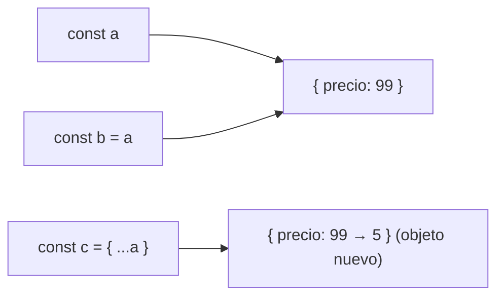
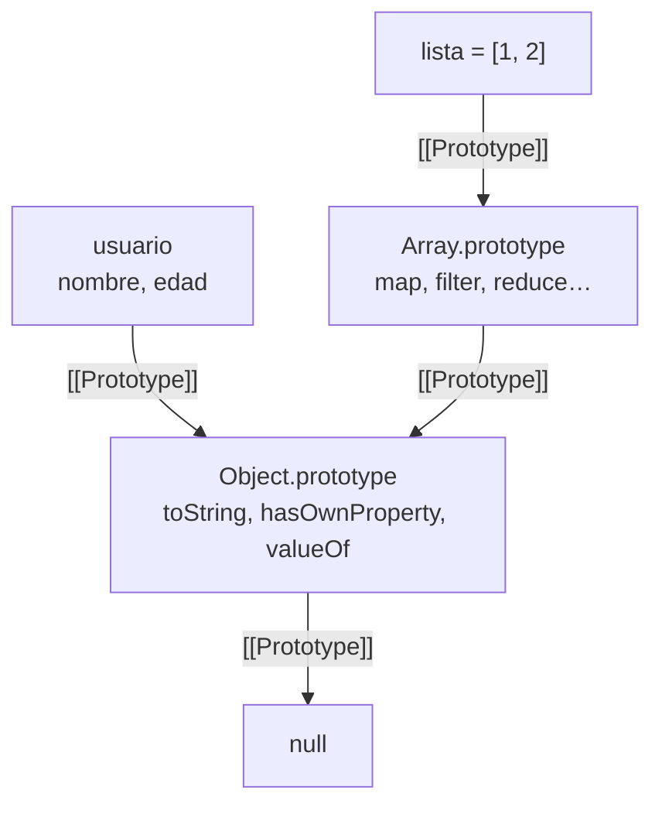
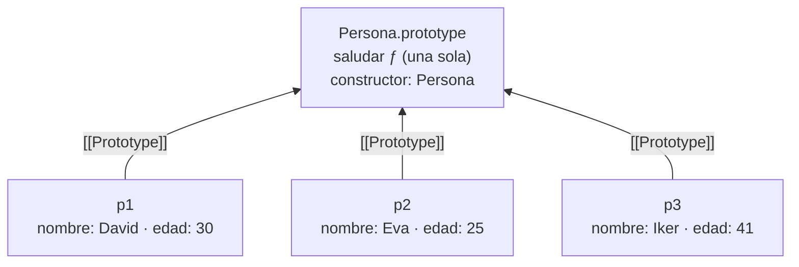
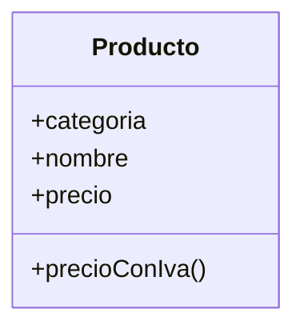
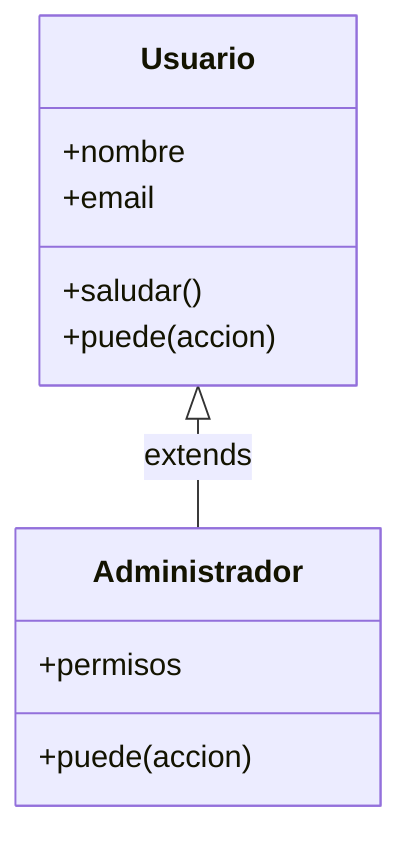
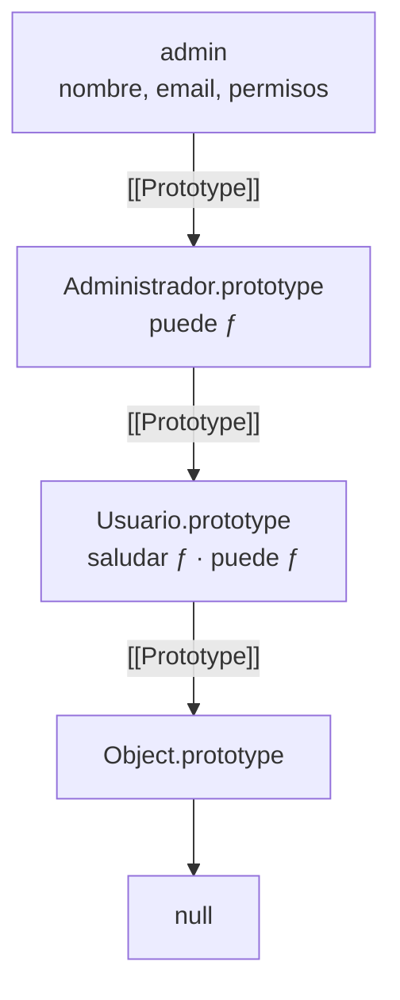
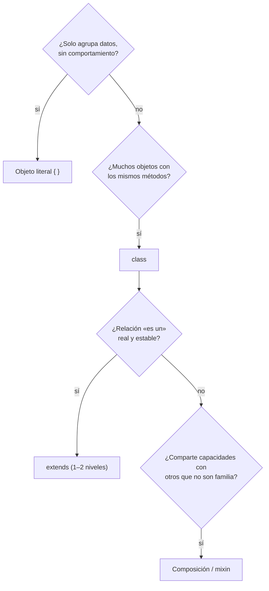
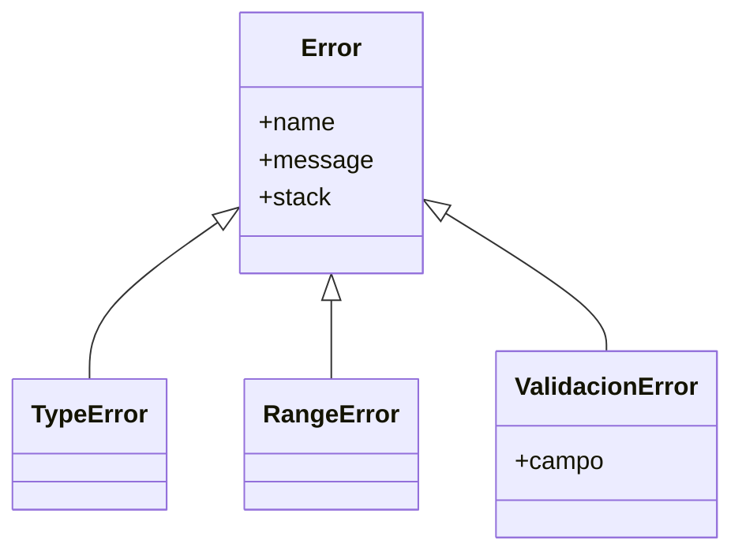
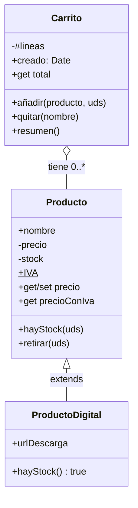

# UD 4: Objetos y Programación Orientada a Objetos (RA3)

<div class="presentacion" markdown>
:material-presentation-play:{ .presentacion__icono } **Presentación de clase** · 55 diapositivas para seguir la unidad

[:material-file-pdf-box: Abrir o descargar el PDF](../assets/presentaciones/DWEC-UD4.pdf){ .md-button .md-button--primary target="_blank" }
</div>

> **Referencia Módulo DWEC:** Resultado de Aprendizaje 3 (RA3) — Desarrolla aplicaciones web utilizando el modelo de objetos de JavaScript, integrando estructuras clave-valor, la cadena de prototipos nativa, clases ES6+, herencia y mecanismos modernos de encapsulamiento, y aprovechando los objetos predefinidos del lenguaje.

---

## 1. Dónde estamos: de datos sueltos a modelos con comportamiento :material-map-marker-path:

| Unidad | Qué aprendimos | Qué aporta hoy |
|---|---|---|
| UD1 – UD2 | Sintaxis, tipos, funciones, `this`, closures | `this` es la base de los métodos |
| UD3 | Arrays, `map` / `filter` / `reduce`, desestructuración, spread | Transformar objetos con lo que ya sabes de arrays |
| **UD4 (hoy)** | **Objetos y POO** | **Modelar el dominio: datos + comportamiento** |
| UD5 | DOM y eventos | Pintar ese modelo en la página |

La pregunta de la unidad: **¿cómo represento en código las cosas de mi aplicación (usuarios, productos, pedidos) con sus datos y lo que saben hacer?**

La **programación orientada a objetos (POO)** organiza el código agrupando **estado** (datos) y **comportamiento** (funciones) en objetos que representan conceptos del problema. En una tienda online, `carrito.añadir(producto)` o `pedido.calcularTotal()` se leen casi como el propio negocio.

!!! warning "JavaScript es distinto a Java o C#"
    Por debajo, JavaScript **no tiene clases**: tiene objetos enlazados con otros objetos (**prototipos**). La palabra `class` existe desde 2015, pero es una forma cómoda de escribir ese modelo. Por eso esta unidad va **de abajo arriba**: objetos → prototipos → clases → herencia y composición → objetos nativos.

---

## 2. Objetos literales: pares clave → valor :material-code-braces:

Un **objeto** es una colección de **propiedades**; cada propiedad es un par **clave → valor**. Las claves son siempre `string` (o `Symbol`); los valores pueden ser cualquier cosa. Cuando el valor es una función, la propiedad se llama **método**.

```javascript
const usuario = {
  nombre: "Ana",
  edad: 31,
  activo: true,
  roles: ["editor", "admin"],      // un array también es un objeto
  direccion: { ciudad: "Sevilla" }, // objeto anidado
  saludar() {                       // método (sintaxis corta, ES2015)
    return `Hola, soy ${this.nombre}`;
  },
};
```

!!! note "Todo lo que no es primitivo es un objeto"
    Los primitivos son `string`, `number`, `boolean`, `null`, `undefined`, `bigint` y `symbol`. Todo lo demás (arrays, fechas, funciones…) es un objeto: `typeof []` devuelve `"object"`.

### 2.1. Punto o corchetes

| Notación | Ejemplo | Cuándo |
|---|---|---|
| Punto | `usuario.nombre` | La clave es un identificador válido. Es la habitual. |
| Corchetes | `usuario[clave]` | La clave está en una variable, tiene guiones o espacios, o se calcula al vuelo. |

```javascript
const campo = "email";
usuario.campo;           // undefined → busca una clave llamada literalmente "campo"
usuario[campo];          // como usuario.email → lo de dentro se EVALÚA
usuario["fecha-alta"];   // con guion: solo con corchetes

usuario.telefono = "600 000 000"; // añade
usuario.edad = 32;                // cambia
delete usuario.activo;            // borra
usuario.dni;                      // undefined: leer algo que no existe NO da error
usuario.dni.length;               // ✗ TypeError: el error llega al acceder a undefined.algo
```

Atajos al crear (ES2015):

```javascript
const nombre = "Luis";
const p = { nombre, [campo]: "l@x.es" }; // propiedad abreviada + clave calculada
// { nombre: "Luis", email: "l@x.es" }
```

!!! tip "Ya lo conoces de la UD3"
    `usuario?.direccion?.ciudad` no revienta si falta `direccion`, y `const { nombre, edad } = usuario` saca varias propiedades a la vez (desestructuración, con valores por defecto y alias).

---

## 3. Métodos y `this` :material-cursor-default-click:

Dentro de un método, **`this` es el objeto que está a la izquierda del punto en la llamada**. Se decide al **llamar**, no al escribir el método.

```javascript
const contador = {
  valor: 0,
  incrementar() {
    this.valor++;
    return this.valor;
  },
};

contador.incrementar(); // 1 → this === contador

const otro = { valor: 100, incrementar: contador.incrementar };
otro.incrementar();     // 101 → mismo método, otro this
```

!!! danger "Trampa: los métodos no se escriben con flecha"
    Las funciones flecha **no tienen `this` propio**: usan el del ámbito donde se escribieron. `incrementar: () => this.valor++` no funciona (en un módulo, `this` es `undefined` fuera de cualquier función). Los métodos de objetos y clases se escriben con la sintaxis corta `metodo() { … }`. Las flechas son ideales, en cambio, como callbacks **dentro** de un método (UD2).

---

## 4. Referencias y copias :material-call-split:

La variable **no guarda el objeto**: guarda una **referencia** (una flecha) hacia él.



```javascript
const a = { precio: 10, dir: { ciudad: "Sevilla" } };
const b = a;            // copia la FLECHA: mismo objeto
b.precio = 99;
a.precio;               // 99

const c = { ...a };     // objeto NUEVO, copia SUPERFICIAL
c.precio = 5;           // a no cambia
c.dir.ciudad = "Cádiz"; // ¡a.dir.ciudad también! dir sigue compartido
```

| Operación | Qué hace | Úsala para |
|---|---|---|
| `b = a` | Copia la referencia (mismo objeto) | Compartir a propósito |
| `{ ...a }` | Objeto nuevo, copia de **un** nivel | Cambiar propiedades sin tocar el original |
| `structuredClone(a)` | Copia profunda (todos los niveles) | Clonar datos anidados. Lanza error si hay funciones; las instancias de clase pierden su clase |
| `a === b` | ¿Es **la misma** referencia? | Ojo: `{ x: 1 } === { x: 1 }` es `false` |

!!! note "Recuerda la UD2"
    Primitivos por valor, objetos por referencia. Si pasas un objeto a una función, la función recibe una copia de la flecha y **puede modificar** el original. Por eso en la UD3 preferíamos devolver objetos nuevos en vez de mutar.

---

## 5. Recorrer y proteger objetos :material-format-list-bulleted:

### 5.1. `Object.keys`, `values` y `entries`

Un objeto no tiene `map` ni `filter`, pero tres métodos estáticos lo convierten en array:

```javascript
const stock = { teclado: 12, raton: 0, monitor: 4 };

Object.keys(stock);    // ["teclado", "raton", "monitor"]
Object.values(stock);  // [12, 0, 4]
Object.entries(stock); // [["teclado", 12], ["raton", 0], ["monitor", 4]]

for (const [prod, uds] of Object.entries(stock)) {
  console.log(`${prod}: ${uds}`);
}

const agotados = Object.keys(stock).filter((k) => stock[k] === 0); // ["raton"]

// Transformar un objeto entero: entries → map → fromEntries
const precios = { teclado: 50, raton: 15 };
const conIva = Object.fromEntries(
  Object.entries(precios).map(([k, v]) => [k, v * 1.21])
);
```

!!! tip "¿Y `for…in`?"
    `for…in` recorre también las propiedades **heredadas** del prototipo (sección 6). Por eso hoy se prefiere `Object.keys` / `Object.entries` con `for…of`. Y nunca `for…in` sobre arrays (UD3).

### 5.2. `const`, `Object.seal` y `Object.freeze`

| | Reasignar la variable | Cambiar valores | Añadir propiedades | Borrar propiedades |
|---|---|---|---|---|
| `const obj` | ✗ | ✓ | ✓ | ✓ |
| `Object.seal(obj)` | — | ✓ | ✗ | ✗ |
| `Object.freeze(obj)` | — | ✗ | ✗ | ✗ |

```javascript
const CONFIG = Object.freeze({ iva: 0.21, moneda: "EUR" });
CONFIG.iva = 0;   // en un módulo (Vite): TypeError; fuera de modo estricto: se ignora en silencio
CONFIG = {};      // TypeError: Assignment to constant variable

const datos = Object.freeze({ dir: { cp: "41001" } });
datos.dir.cp = "28001"; // ¡funciona! freeze es SUPERFICIAL
```

!!! info "Modo estricto"
    Los módulos ES (`<script type="module">`, todos los ficheros de Vite) y el cuerpo de las clases van siempre en **modo estricto**, que convierte muchos errores silenciosos en excepciones. Varios ejemplos de esta unidad solo lanzan error por eso.

---

## 6. Prototipos: lo que hay debajo :material-link-variant:

### 6.1. El problema: muchos objetos con los mismos métodos

Una **función fábrica** crea objetos sin repetir el literal…

```javascript
function crearUsuario(nombre) {
  return {
    nombre,
    saludar() {
      return `Hola, ${this.nombre}`;
    },
  };
}
const u1 = crearUsuario("Ana");
const u2 = crearUsuario("Luis");
u1.saludar === u2.saludar; // false → cada objeto lleva SU copia de la función
```

…pero cada objeto lleva su propia copia de `saludar`: mil usuarios, mil funciones idénticas. JavaScript resuelve esto con los **prototipos**.

### 6.2. `[[Prototype]]` y la cadena de prototipos

Todo objeto tiene un **enlace interno** a otro objeto, su **prototipo**. En la especificación (y en DevTools) se llama `[[Prototype]]` y se consulta con `Object.getPrototypeOf(obj)`.



```javascript
const usuario = { nombre: "Ana", edad: 31 };
usuario.toString();                                   // "[object Object]" — ¿de dónde sale?
Object.getPrototypeOf(usuario) === Object.prototype;  // true: de ahí
Object.getPrototypeOf([1, 2]) === Array.prototype;    // true: por eso todos los arrays tienen map
```

!!! note "`__proto__`"
    Es la forma antigua de acceder a ese enlace. Sigue funcionando por compatibilidad, pero en código nuevo se usa `Object.getPrototypeOf` / `Object.create`.

### 6.3. Cómo busca JavaScript una propiedad

1. ¿Es **propiedad propia** del objeto? → la usa.
2. Si no, la busca en su **prototipo**.
3. Si tampoco, sube al prototipo del prototipo…
4. Si llega a `null` sin encontrarla → `undefined`.

```javascript
"nombre" in usuario;                // true
"toString" in usuario;              // true (heredada): in mira toda la cadena
Object.hasOwn(usuario, "nombre");   // true
Object.hasOwn(usuario, "toString"); // false: hasOwn solo mira el propio objeto
```

**Sombreado (*shadowing*)**: si el objeto tiene una propiedad propia con el mismo nombre que una heredada, se encuentra la propia primero. Así se «sobrescribe» un método heredado.

!!! warning "Leer sube por la cadena; escribir, no"
    `usuario.toString = () => "Soy Ana"` **no** cambia `Object.prototype`: crea una propiedad propia en `usuario`.

### 6.4. Funciones constructoras y `new` (la forma clásica)

Antes de 2015 se usaban **funciones constructoras** (con mayúscula por convención) llamadas con `new`:

```javascript
function Persona(nombre, edad) {
  this.nombre = nombre;
  this.edad = edad;
}
Persona.prototype.saludar = function () {
  return `Hola, soy ${this.nombre}`;
};

const p = new Persona("David", 30);
p.saludar(); // "Hola, soy David"
```

Lo que hace `new Persona("David", 30)`:

1. Crea un objeto vacío `{}`.
2. Lo **enlaza** al prototipo: su `[[Prototype]]` pasa a ser `Persona.prototype`.
3. Ejecuta `Persona` con `this` = ese objeto (`this.nombre = "David"`…).
4. Lo devuelve.

!!! danger "Sin `new` no funciona"
    `Persona("David", 30)` ejecuta la función con `this = undefined` (modo estricto) y lanza `TypeError`. En código antiguo, sin modo estricto, `this` era el objeto global y se creaban variables globales por accidente.

### 6.5. Los métodos viven una vez en el prototipo



| | Fábrica | Prototipo |
|---|---|---|
| Datos (nombre, edad) | en cada objeto | en cada objeto |
| Métodos | copiados en cada uno | **una vez**, compartidos |
| 1 000 objetos | 1 000 funciones | 1 función |

**Regla:** los **datos** van en cada objeto (`this.x` en el constructor); el **comportamiento**, en el prototipo.

!!! danger "No modifiques los prototipos nativos"
    `Array.prototype.miMetodo = …` funciona, pero rompe librerías (*monkey patching*). El método `Array.prototype.flat` se llama así, y no `flatten`, porque una librería antigua ya había añadido un `flatten` incompatible.

!!! question "`prototype` y `[[Prototype]]` no son lo mismo"
    `Persona.prototype` es una **propiedad de la función**: el objeto que se usará como prototipo de lo que cree `new Persona()`. `[[Prototype]]` es el **enlace** que tiene cada objeto. Se cumple `Object.getPrototypeOf(p) === Persona.prototype`.

### 6.6. `Object.create`: herencia entre objetos

```javascript
const animal = {
  describir() {
    return `${this.nombre} hace ${this.sonido}`;
  },
};
const gato = Object.create(animal); // gato → animal
gato.nombre = "Misi";
gato.sonido = "miau";
gato.describir(); // "Misi hace miau"
```

| Herramienta | Para qué |
|---|---|
| `Object.getPrototypeOf(obj)` | Ver el prototipo de un objeto |
| `Object.create(proto)` | Crear un objeto con ese prototipo (`Object.create(null)`: sin prototipo) |
| `obj instanceof Clase` | ¿Está `Clase.prototype` en la cadena de `obj`? |
| `console.dir(obj)` | Ver el objeto desplegable con su `[[Prototype]]` |

### 6.7. `class` es azúcar sintáctico

=== "Antes (función constructora)"

    ```javascript
    function Persona(nombre) {
      this.nombre = nombre;
    }
    Persona.prototype.saludar = function () {
      return `Hola, soy ${this.nombre}`;
    };
    ```

=== "Ahora (class, ES2015)"

    ```javascript
    class Persona {
      constructor(nombre) {
        this.nombre = nombre;
      }
      saludar() {
        return `Hola, soy ${this.nombre}`;
      }
    }
    ```

En los dos casos `typeof Persona === "function"` y `saludar` está en `Persona.prototype`. **Azúcar sintáctico** = otra forma de escribir algo que ya existía. Lo que `class` añade de verdad:

- Obliga a usar `new` (sin `new`: `TypeError`).
- El cuerpo va siempre en modo estricto.
- Los métodos no son enumerables (no salen en `for…in`).
- Permite `#privados`, `static` y `extends`/`super` cómodos.

---

## 7. Clases :material-shape-outline:

### 7.1. Anatomía de una clase

```javascript
class Producto {
  categoria = "general";        // ① campo público (uno por instancia)

  constructor(nombre, precio) { // ② constructor: se ejecuta solo con new
    this.nombre = nombre;
    this.precio = precio;
  }

  precioConIva() {              // ③ método: va al prototipo (compartido)
    return this.precio * 1.21;
  }
}

const teclado = new Producto("Teclado", 50); // ④ instancia
```



En **UML** (diagrama de clases): nombre arriba, atributos en medio, métodos abajo; `+` público, `-` privado, subrayado o `static` para lo estático.

### 7.2. El constructor deja el objeto en un estado válido… o no lo crea

```javascript
class Producto {
  constructor(nombre, precio = 0, stock = 0) {
    if (!nombre?.trim()) {
      throw new Error("El nombre es obligatorio");
    }
    if (precio < 0) {
      throw new RangeError("Precio negativo");
    }
    this.nombre = nombre.trim();
    this.precio = precio;
    this.stock = stock;
  }
}

new Producto("Ratón", 15); // ✓
new Producto("", 15);      // ✗ Error: El nombre es obligatorio
Producto("Ratón", 15);     // ✗ TypeError: Class constructor Producto cannot be invoked without 'new'
```

!!! note "Las clases no se elevan (*hoisting*)"
    Usar una clase antes de la línea donde se declara da `ReferenceError` (zona muerta temporal, UD2). En la práctica, cada clase va en su fichero y se importa arriba.

### 7.3. Getters y setters

`get` y `set` son métodos que **se usan como si fueran propiedades**: sirven para validar al escribir y calcular al leer.

```javascript
class Producto {
  #precio = 0;

  constructor(nombre, precio) {
    this.nombre = nombre;
    this.precio = precio;  // ← pasa por el set: validación en un solo sitio
  }

  get precio() {
    return this.#precio;
  }

  set precio(valor) {
    if (valor < 0) throw new RangeError("Precio negativo");
    this.#precio = valor;
  }

  get precioConIva() {     // propiedad calculada, solo lectura
    return this.#precio * 1.21;
  }
}

const p = new Producto("Teclado", 50);
p.precio;            // 50       → get precio()
p.precio = 20;       // ✓        → set precio(20)
p.precio = -5;       // ✗ RangeError
p.precioConIva;      // 24.2     → sin paréntesis
p.precioConIva = 9;  // ✗ TypeError en modo estricto: solo tiene getter
```

!!! tip "Solo cuando aporten algo"
    Un get/set que solo copia el valor sobra. Úsalos para **validar, calcular o proteger**. Y el getter no debe tener efectos secundarios ni ser lento. Ojo: `get precio() { return this.precio; }` se llama a sí mismo sin fin (`RangeError: Maximum call stack size exceeded`); por eso el dato va en `#precio`.

### 7.4. Encapsulación: campos y métodos privados con `#`

**Encapsular** es esconder el estado interno y exponer solo una **interfaz pública** que garantiza que el estado siempre es válido. Desde ES2022, todo lo que empieza por `#` solo existe dentro del cuerpo de la clase.

```javascript
class CuentaBancaria {
  #saldo = 0;                 // campo privado (hay que declararlo)

  constructor(titular) {
    this.titular = titular;   // público
  }

  ingresar(cantidad) {
    this.#validar(cantidad);
    this.#saldo += cantidad;
  }

  get saldo() {
    return this.#saldo;
  }

  #validar(cantidad) {        // método privado
    if (cantidad <= 0) throw new RangeError("Cantidad no válida");
  }
}

const cuenta = new CuentaBancaria("Marcos");
cuenta.ingresar(100);
cuenta.saldo;         // 100
cuenta.#saldo = 1e6;  // ✗ SyntaxError: Private field '#saldo' must be declared in an enclosing class
```

### 7.5. Tres formas de «privado»

| | `_saldo` (convención) | closure (UD2) | `#saldo` (ES2022) |
|---|---|---|---|
| ¿Accesible desde fuera? | Sí, cualquiera | No | No |
| ¿Quién lo impide? | Nadie: es un aviso | El ámbito de la función | El propio lenguaje |
| Error al intentarlo | Ninguno | Es `undefined` | `SyntaxError` al cargar |
| ¿Sale en `Object.keys` / JSON? | Sí | No | No |
| Dónde lo verás | Código antiguo | Fábricas, módulos | Clases modernas |

!!! danger "Es un `SyntaxError`, no un error normal"
    Se detecta **al leer el fichero**, antes de ejecutarlo: si escribes `obj.#saldo` fuera de la clase, **no se ejecuta ninguna línea** de ese script o módulo. Tampoco se puede capturar con `try/catch`.

!!! info "La consola de Chrome sí te deja verlo"
    Para depurar, la consola de DevTools permite leer `cuenta.#saldo`. No significa que sea público: en tu código fuente fallará.

Dentro de la clase, `#saldo in obj` comprueba si `obj` tiene ese campo privado (ES2022).

### 7.6. `static`: lo que pertenece a la clase

```javascript
class Pedido {
  static #contador = 0;  // privado y de la clase
  static IVA = 0.21;     // constante de la clase

  constructor(lineas) {
    this.id = ++Pedido.#contador;
    this.lineas = lineas;
  }

  static desdeJSON(texto) {   // método fábrica
    const datos = JSON.parse(texto);
    return new Pedido(datos.lineas);
  }
}

Pedido.IVA;                    // 0.21
new Pedido([]).IVA;            // undefined: no es de la instancia
Pedido.desdeJSON('{"lineas":[]}').id;
```

Usos típicos: constantes, contadores, **métodos fábrica**, utilidades. `Math.max`, `Date.now`, `Object.keys` o `Number.isNaN` son métodos estáticos.

!!! tip "¿Método normal o `static`?"
    ¿Necesita los datos de **una** instancia concreta (`this`)? → método normal. ¿No? → `static`.

### 7.7. El `this` perdido

Si pasas un método como **callback** sin su objeto, pierde su `this`.

```javascript
class Temporizador {
  segundos = 0;
  tic() { this.segundos++; }
}
const t = new Temporizador();

const f = t.tic;
f();                       // ✗ TypeError: Cannot read properties of undefined (reading 'segundos')
[1, 2].forEach(t.tic);     // ✗ el mismo TypeError
setInterval(t.tic, 1000);  // ✗ sin error… y no cuenta
```

`t.tic` (sin paréntesis) es **solo la función**, sin el `t.` delante. Quien la llame después decide `this`: en una llamada suelta es `undefined`; `setInterval` la llama con `this = window`, así que suma en `window.segundos` (que acaba valiendo `NaN`) y `t.segundos` se queda en 0. **Falla en silencio.** En la UD5 pasará lo mismo con `addEventListener`.

| Solución | Código | Cuándo |
|---|---|---|
| Flecha al pasarla | `setInterval(() => t.tic(), 1000)` | La habitual |
| `bind` | `setInterval(t.tic.bind(t), 1000)` | Fijar `this` en una función reutilizable |
| Campo flecha | `tic = () => { this.segundos++; };` | Manejadores de eventos (crea una función por instancia) |

---

## 8. Herencia :material-family-tree:

### 8.1. `extends` y `super`

La **herencia** permite que una clase (subclase) obtenga las propiedades y métodos de otra (superclase) y añada o cambie comportamiento. En JavaScript es **simple**: un único padre.



```javascript
class Usuario {
  constructor(nombre, email) {
    this.nombre = nombre;
    this.email = email;
  }
  saludar() { return `Hola, ${this.nombre}`; }
  puede(accion) { return accion === "leer"; }
}

class Administrador extends Usuario {
  constructor(nombre, email, permisos) {
    super(nombre, email);        // constructor del padre
    this.permisos = permisos;
  }
  puede(accion) { return this.permisos.includes(accion); }
}

const admin = new Administrador("Eva", "e@x.es", ["leer", "borrar"]);
admin.saludar();        // heredado: "Hola, Eva"
admin.puede("borrar");  // propio: true
```

### 8.2. `super()` antes de `this`

El objeto lo crea la **clase base**: al hacer `new Administrador(…)`, el constructor de `Administrador` llama a `super(…)`, el de `Usuario` crea el objeto y su `this`, y solo entonces `Administrador` puede completarlo.

```javascript
class Administrador extends Usuario {
  constructor(nombre, email, permisos) {
    this.permisos = permisos;   // ✗ antes de super
    super(nombre, email);
  }
}
// ReferenceError: Must call super constructor in derived class before accessing 'this' or returning from derived constructor
```

- Si la subclase **no** escribe constructor, JavaScript pone uno: `constructor(...args) { super(...args); }`.
- Si lo escribe, **debe** llamar a `super()` antes de usar `this`.

### 8.3. Sobrescritura y polimorfismo

```javascript
class Figura {
  area() { return 0; }
  describir() {
    return `${this.constructor.name}: ${this.area().toFixed(2)}`;
  }
}
class Circulo extends Figura {
  constructor(r) { super(); this.r = r; }
  area() { return Math.PI * this.r ** 2; }
}
class Rectangulo extends Figura {
  constructor(a, b) { super(); this.a = a; this.b = b; }
  area() { return this.a * this.b; }
}

const figuras = [new Circulo(1), new Rectangulo(2, 3)];
figuras.map((f) => f.describir()); // ["Circulo: 3.14", "Rectangulo: 6.00"]
```

- **Sobrescribir** (*override*): la subclase define un método con el mismo nombre que el heredado.
- **`super.metodo()`**: reutiliza la versión del padre y la amplía (`describir() { return super.describir() + " (admin)"; }`).
- **Polimorfismo**: el código que recorre `figuras` no pregunta qué tipo es cada una; cada objeto responde a su manera al mismo mensaje.

!!! tip "Señal de que quieres polimorfismo"
    Si te descubres escribiendo `if (tipo === "circulo") … else if (tipo === "rectangulo") …`, probablemente cada tipo debería ser una clase con su propio método.

### 8.4. La cadena con clases e `instanceof`

`extends` **enlaza prototipos**: es la misma cadena de la sección 6.



```javascript
admin instanceof Administrador; // true
admin instanceof Usuario;       // true
admin instanceof Object;        // true
Object.getPrototypeOf(Administrador.prototype) === Usuario.prototype; // true
```

`instanceof` no mira «con qué clase se creó» el objeto: mira si `Clase.prototype` aparece **en algún punto** de su cadena.

---

## 9. Composición frente a herencia :material-puzzle-outline:

### 9.1. «Es un» o «tiene un»

| | Herencia (`extends`) | Composición |
|---|---|---|
| Relación | **es un**: Administrador ES UN Usuario | **tiene un**: Coche TIENE UN Motor |
| Acoplamiento | Fuerte: si cambia el padre, cambian los hijos | Débil: las piezas se cambian |
| Riesgo | Jerarquías rígidas y profundas | Algo más de código para conectar |
| Encaja si | La jerarquía es real, estable y poco profunda | Se combinan comportamientos o pueden cambiar |

> «*Favor object composition over class inheritance*» — Gamma, Helm, Johnson y Vlissides, *Design Patterns* (1994). No significa «nunca heredes»: significa preguntarse cada vez si la relación es de verdad «es un».

### 9.2. Composición en práctica: delegar

```javascript
class Motor {
  constructor(cv) { this.cv = cv; }
  arrancar() { return `Motor de ${this.cv} CV en marcha`; }
}
class MotorElectrico {
  arrancar() { return "Zumbido silencioso"; }
}

class Coche {
  constructor(modelo, motor) {
    this.modelo = modelo;
    this.motor = motor;          // TIENE UN motor
  }
  arrancar() {
    return `${this.modelo}: ${this.motor.arrancar()}`; // delega
  }
}

new Coche("León", new Motor(150)).arrancar();
new Coche("Born", new MotorElectrico()).arrancar();
```

- Cambiar de motor es pasar otro objeto, **sin tocar `Coche`**.
- `Coche` acepta cualquier objeto con un método `arrancar()` (*duck typing*).
- Con herencia harían falta `CocheGasolina`, `CocheElectrico`, `CocheHibrido`… y se multiplican con cada variante nueva.

### 9.3. El problema del pingüino: combinar capacidades (mixins)

Si `Ave` sabe `volar()` y `Pinguino extends Ave`, el pingüino hereda algo que no puede hacer. Y pato y pez nadan, pero no son de la misma familia. Solución: capacidades sueltas que se copian donde hacen falta (**mixins**).

```javascript
const puedeVolar = {
  volar() { return `${this.nombre} vuela`; },
};
const puedeNadar = {
  nadar() { return `${this.nombre} nada`; },
};

const pato = Object.assign({ nombre: "Pato" }, puedeVolar, puedeNadar);
const pinguino = Object.assign({ nombre: "Pingu" }, puedeNadar);
pinguino.nadar(); // "Pingu nada"
```

Los métodos usan `this`, así que funcionan en cualquier objeto que tenga `nombre`. `Object.assign(destino, ...origenes)` copia las propiedades propias de los orígenes en el destino (copia superficial) y lo devuelve.

### 9.4. Cuatro preguntas antes de escribir `class`



Lo que **no** vale nunca: heredar solo «para reutilizar código» sin una relación real.

---

## 10. Objetos nativos del lenguaje :material-toolbox-outline:

JavaScript trae objetos listos para usar. Antes de escribir una función, comprueba si ya existe.

| Objeto | Para qué | Ejemplos |
|---|---|---|
| `Math` | Cálculos | `Math.round`, `Math.random`, `Math.max` |
| `Number` | Números | `Number()`, `Number.parseFloat`, `Number.isNaN`, `toFixed` |
| `String` | Texto | `trim`, `includes`, `padStart`, `split`, `replaceAll` |
| `Date` | Fechas y horas | `new Date()`, `Date.now()`, `getFullYear` |
| `Intl` | Formato según idioma | Moneda en euros, fechas en español |
| `Array` | Listas (UD3) | `map`, `filter`, `reduce` |
| `JSON` | Texto ↔ objeto (UD6) | `JSON.stringify`, `JSON.parse` |
| `Error` | Errores | `throw new Error(…)` |
| `Map` / `Set` | Diccionarios / valores sin repetir | `new Map()`, `get`, `set`, `has` |

`Math`, `JSON` e `Intl` no se instancian con `new`: son objetos con métodos estáticos. `Date`, `Error` o `Map` son clases.

!!! question "¿Por qué `\"hola\".toUpperCase()` funciona si `\"hola\"` es un primitivo?"
    JavaScript lo envuelve un instante en un objeto `String` (*autoboxing*) y busca el método en `String.prototype`. Otra vez la cadena de prototipos. Nunca crees envoltorios a mano (`new String("x")`).

### 10.1. `Math` y `Number`

| Valor | `round` | `floor` | `ceil` | `trunc` |
|---|---|---|---|---|
| `2.5` | 3 | 2 | 3 | 2 |
| `-2.5` | -2 | -3 | -2 | -2 |
| `2.49` | 2 | 2 | 3 | 2 |

```javascript
// Entero aleatorio entre min y max (ambos incluidos)
const azar = (min, max) => Math.floor(Math.random() * (max - min + 1)) + min;

Math.max(...[4, 9, 2]);       // 9 (spread, UD3)
Math.min();                   // Infinity (¡ojo con arrays vacíos!)

0.1 + 0.2;                    // 0.30000000000000004
(0.1 + 0.2).toFixed(2);       // "0.30"  ← STRING
"0.30" + 1;                   // "0.301" (concatena)
Number("12.5");               // 12.5
Number("12,5");               // NaN: la coma no es decimal en JS
Number.parseFloat("12.5€");   // 12.5: lee hasta donde puede
Number.isNaN(NaN);            // true
NaN === NaN;                  // false
```

!!! warning "Dinero"
    Los decimales se guardan en binario (IEEE 754) y muchos no son exactos: pasa en todos los lenguajes. Redondea **solo al mostrar** (`toFixed` / `Intl`) o trabaja en **céntimos enteros** (`1999` en vez de `19.99`). Nunca compares decimales con `===`.

### 10.2. `Date`

```javascript
const ahora = new Date();
const examen = new Date(2026, 10, 27);       // ¡27 de NOVIEMBRE! (meses 0–11)
const iso = new Date("2026-11-27T09:00");    // ISO con hora: hora local
const utc = new Date("2026-11-27");          // ISO SIN hora: medianoche UTC (01:00 en España)

examen.getFullYear(); // 2026
examen.getMonth();    // 10 (0 = enero)
examen.getDate();     // 27 (día del mes)
examen.getDay();      // 5  (día de la SEMANA, 0 = domingo)

const dias = Math.ceil((examen - ahora) / 86_400_000); // restar fechas da milisegundos
Date.now();           // ms desde el 1-1-1970 (marca de tiempo)
```

| Trampa | Explicación |
|---|---|
| Meses de 0 a 11 | `new Date(2026, 10, 27)` es noviembre |
| `getDay` ≠ `getDate` | `getDay` = día de la semana; `getDate` = día del mes |
| Restar da ms | 1 día = 86 400 000 ms |
| Es mutable | `setDate()` cambia el objeto original |
| ISO sin hora = UTC | `new Date("2026-11-27")` es medianoche **UTC**: en América cae el día 26. Añade la hora (`"2026-11-27T00:00"`) o usa números |
| Formatos no ISO | `new Date("27/11/2026")` no está estandarizado: usa números o ISO |

!!! note "Temporal"
    `Temporal` es la nueva API de fechas del lenguaje (inmutable y sin estas trampas). Está llegando a los navegadores, pero `Date` seguirá en todo el código existente durante años.

### 10.3. `String` e `Intl`

```javascript
const entrada = "  Ana@Correo.ES  ";
entrada.trim().toLowerCase();    // "ana@correo.es"
"Teclado".includes("cla");       // true
"7".padStart(3, "0");            // "007"
"a-b-c".split("-");              // ["a", "b", "c"]
"2026-11-27".slice(0, 4);        // "2026"
"x.y.z".replaceAll(".", "/");    // "x/y/z"

// Los strings son INMUTABLES
entrada.trim();  // devuelve uno nuevo…
entrada;         // …y entrada sigue con espacios
```

`Intl` formatea números, monedas, fechas y plurales según el idioma:

```javascript
const eur = new Intl.NumberFormat("es-ES", { style: "currency", currency: "EUR" });
eur.format(1234.5);   // "1234,50 €"
eur.format(12345.5);  // "12.345,50 €"

examen.toLocaleDateString("es-ES", { weekday: "long", day: "numeric", month: "long" });
// "viernes, 27 de noviembre"
```

!!! tip "Sin punto de millares en 4 cifras"
    `1234,50 €` sale sin punto: la norma española no agrupa los números de cuatro cifras. No es un error. Y nada de concatenar `" €"` ni cambiar puntos por comas a mano.

### 10.4. `Error` es una clase… y se puede heredar



```javascript
class ValidacionError extends Error {
  constructor(campo, mensaje) {
    super(mensaje);
    this.name = "ValidacionError";
    this.campo = campo;
  }
}

try {
  throw new ValidacionError("email", "Email no válido");
} catch (e) {
  if (e instanceof ValidacionError) {
    console.warn(e.campo, e.message);  // error esperado: se muestra al usuario
  } else {
    throw e;                           // un bug: que siga subiendo
  }
}
```

Herencia bien usada: un `ValidacionError` **es un** `Error`. Lanza siempre `new Error(…)` o una subclase, nunca `throw "texto"` (sin `stack` ni `instanceof`). Lo usarás en formularios (UD5) y con `fetch` (UD6).

### 10.5. `Map` y `Set`: colecciones con clave

Un objeto literal sirve para describir **una cosa** con campos fijos (`{ nombre, precio }`). Cuando lo que quieres es un **diccionario** al que añades, buscas y quitas entradas mientras el programa funciona (nombre → columna, ISBN → libro, id → tarea), mejor un `Map`.

```javascript
const stock = new Map([          // se puede crear vacío o con pares [clave, valor]
  ["teclado", 5],
  ["ratón", 0],
]);

stock.set("monitor", 2);         // añadir (o cambiar, si ya estaba)
stock.get("teclado");            // 5
stock.get("altavoz");            // undefined: no está
stock.has("ratón");              // true   ← ¿existe esa clave?
stock.delete("monitor");         // true si estaba (false si no)
stock.size;                      // 2      (propiedad, sin paréntesis)

for (const [producto, uds] of stock) console.log(producto, uds);   // en orden de inserción
[...stock.keys()];               // ["teclado", "ratón"]
[...stock.values()];             // [5, 0]
[...stock];                      // [["teclado", 5], ["ratón", 0]] → ya puedes usar filter, map…
```

**`has` antes de usar.** Lo normal es comprobar que la clave existe y, si no, lanzar un error con el nombre que ha fallado:

```javascript
class Almacen {
  #estanterias = new Map();            // nombre → array de productos

  constructor(nombres) {
    for (const n of nombres) this.#estanterias.set(n, []);
  }

  estanteria(nombre) {
    if (!this.#estanterias.has(nombre)) throw new Error(`No existe la estantería «${nombre}»`);
    return this.#estanterias.get(nombre);
  }
}

const a = new Almacen(["A", "B"]);
a.estanteria("A");   // []
a.estanteria("Z");   // Error: No existe la estantería «Z»
```

!!! warning "¿Por qué `has` y no `if (!stock.get(clave))`?"
    Porque un valor guardado puede ser **falsy**: `stock.get("ratón")` vale `0`, y `!0` es `true`. El `if` diría «no existe» y el ratón sí está, con 0 unidades. `has` solo responde a una pregunta: si **la clave** está, valga lo que valga.

| | Objeto `{}` | `Map` |
|---|---|---|
| Para qué | Una cosa con campos fijos | Diccionario que crece y cambia |
| Claves | Solo texto (`o[1]` y `o["1"]` son la misma) | Cualquier valor (números, objetos…) |
| ¿Existe la clave? | `Object.hasOwn(o, "k")` (`"toString" in o` da `true`: es heredada) | `m.has(k)`: solo lo que tú has metido |
| Cuántas | `Object.keys(o).length` | `m.size` |
| Recorrer | `Object.entries(o)` | `for…of` directo, en orden de inserción |
| A JSON (UD6) | Directo | `JSON.stringify(m)` da `"{}"`: pásalo antes a array (`[...m]`) |

Para pasar de un objeto a un `Map` y al revés: `new Map(Object.entries(obj))` y `Object.fromEntries(mapa)` (apartado 5.1).

!!! danger "`m.clave = valor` no mete nada en el `Map`"
    Crea una propiedad normal en el objeto, pero `m.has("clave")` sigue siendo `false` y `size` no cambia. Con un `Map`, siempre `set` y `get`.

**`Set`: valores sin repetir.** Es como un `Map` que solo tiene claves: guarda cada valor **una sola vez**.

```javascript
const ciclos = new Set(["DAW", "ASIR", "DAW"]);
ciclos.size;          // 2: el segundo "DAW" no entra
ciclos.add("SMR");    // añadir
ciclos.has("DAW");    // true
ciclos.delete("ASIR");

[...new Set([3, 1, 3, 2, 1])];   // [3, 1, 2]: quitar duplicados de un array en una línea
```

Úsalo cuando solo importa **si algo está o no**: favoritos, etiquetas, ids ya vistos. En la UD6 guardarás favoritos en un `Set`.

---

## 11. Verificar: DevTools :material-bug-check-outline:

| Herramienta | Para qué |
|---|---|
| `console.log(obj)` | Vista rápida. Muestra el estado **al desplegar**, no al imprimir |
| `console.dir(obj)` | Vista como objeto, con `[[Prototype]]` desplegable |
| `console.table(lista)` | Array de objetos como tabla |
| `Object.getPrototypeOf(x)` | Subir un eslabón de la cadena a mano |
| `debugger;` | Pausa en esa línea (con DevTools abierto) para ver `this` y las variables |

```text
> console.dir(admin)
▼ Administrador
    nombre: "Eva"
    email: "e@x.es"
    permisos: (2) ['leer', 'borrar']
  ▼ [[Prototype]]: Usuario
      constructor: class Administrador
      puede: ƒ puede(accion)
    ▼ [[Prototype]]: Object
        saludar: ƒ saludar()
        puede: ƒ puede(accion)
      ▸ [[Prototype]]: Object
```

!!! info "Cómo rotula Chrome los prototipos"
    El primer «`[[Prototype]]: Usuario`» es en realidad `Administrador.prototype` (dentro se ve `constructor: class Administrador`): Chrome etiqueta cada prototipo con el nombre de la clase **de la que hereda**.

Pruébalo con el DOM: `Object.getPrototypeOf(document.body)` y sigue subiendo. Un botón es `HTMLButtonElement → HTMLElement → Element → Node → EventTarget → Object`: la UD5 es usar esa cadena.

---

## 12. Errores comunes :material-alert-circle-outline:

| Error | ✗ Mal | ✓ Bien |
|---|---|---|
| Olvidar `new` | `Producto("Ratón", 15)` | `new Producto("Ratón", 15)` |
| `this` antes de `super()` | `this.permisos = p; super(n, e);` | `super(n, e); this.permisos = p;` |
| Heredar «para reutilizar» | `class Carrito extends Producto` | `class Carrito { #lineas = []; }` |
| Sobrescribir y perder al padre | `describir() { return "Admin"; }` | `describir() { return super.describir() + "!"; }` |
| Método flecha en un objeto | `saludar: () => this.nombre` | `saludar() { return this.nombre; }` |
| Pasar el método sin su objeto | `lista.forEach(t.tic)` | `lista.forEach(() => t.tic())` |
| `_privado` que no es privado | `this._saldo = 0;` | `#saldo = 0;` |
| Meses de `Date` desde 1 | `new Date(2026, 11, 27) // ¿nov?` | `new Date(2026, 10, 27) // nov` |
| Copiar con `=` | `const copia = original;` | `const copia = { ...original };` |
| Sumar tras `toFixed` | `total.toFixed(2) + envio` | `(total + envio).toFixed(2)` |
| Mirar si existe con `get` | `if (!stock.get("ratón"))  // 0 → «no está»` | `if (!stock.has("ratón"))` |

---

## 13. Ejercicio práctico guiado: modelo de una tienda con clases :material-clipboard-check:

Proyecto Vite (como en la Práctica 1) con **un fichero por clase** en `src/modelo/` y un `src/main.js` que solo crea objetos y muestra resultados con `console.log` / `console.table`. **Sin DOM todavía**: es la base del modelo de la Práctica 2.



1. **`Producto`**: `nombre` obligatorio, `precio` con setter que lanza `RangeError` si es negativo (el constructor también pasa por el setter), `#stock` privado, `static IVA = 0.21`, `get precioConIva`, `hayStock(uds)` y `retirar(uds)` (lanza `Error` si no hay stock).
2. **`ProductoDigital extends Producto`**: añade `urlDescarga`, llama bien a `super()` y sobrescribe `hayStock()` (siempre `true`) y `retirar()` (no hace nada).
3. **`Carrito`**: **tiene** productos (no hereda de nadie). Lista privada `#lineas` de `{ producto, uds }`; `añadir(producto, uds)` llama a `producto.retirar(uds)` (así falla si no hay stock) y, si el producto ya está, suma unidades; `quitar(nombre)`, `get total` **redondeado a céntimos** y `get unidades`.
4. **Formato**: `resumen()` devuelve `"3 artículos · 129,98 €"` usando `Intl.NumberFormat`; `creado` guarda la fecha con `Date`.
5. **Comprobar** en `main.js`:

```javascript
const teclado = new Producto("Teclado", 49.99, 5);
const raton = new Producto("Ratón", 15, 3);
const ebook = new ProductoDigital("Ebook JS", 30, "https://ejemplo.es/js.pdf");

const c = new Carrito();
c.añadir(teclado, 2);
c.añadir(ebook, 1);
console.log(c.total);      // 129.98
console.log(c.resumen());  // "3 artículos · 129,98 €"

// Un error no capturado para el módulo entero: cada prueba de error, en su try/catch
try { teclado.precio = -1; } catch (e) { console.log(e.name, e.message); } // RangeError
try { c.añadir(raton, 99); } catch (e) { console.log(e.name, e.message); } // Error: sin stock
console.log(Object.keys(teclado)); // ["nombre"] → los # no salen
```

!!! warning "¿Te sale `129.98000000000002`?"
    Es el problema de los decimales de la sección 10.1 (`2 * 49.99 + 30`). Redondea en `get total`: `Math.round(t * 100) / 100`.

!!! success "Criterio de éxito"
    Precio negativo → `RangeError`; `#stock` inaccesible desde `main.js`; total en formato `129,98 €`; y `Carrito` no hereda de nadie.

!!! tip "Si terminas: descuento por composición"
    Crea `SinDescuento` y `DescuentoPorcentaje` (ambos con un método `aplicar(total)`) y haz que el `Carrito` **tenga** uno y lo use al calcular el total. Cambiar de descuento no debe obligar a tocar `Carrito`.

---

## 14. Comprueba lo aprendido :material-head-question-outline:

??? question "1. ¿Por qué se dice que `class` es azúcar sintáctico? ¿Qué hay debajo?"
    Porque `class` crea una **función** constructora y pone los métodos en su **`prototype`**; los objetos creados con `new` enlazan con él mediante `[[Prototype]]`. No añade un modelo de objetos nuevo: es otra forma de escribir constructoras y prototipos.

??? question "2. `p1` y `p2` son instancias de `Persona`. ¿Cuántas copias de `saludar` existen? ¿Dónde?"
    **Una**, en `Persona.prototype`. Las dos instancias la encuentran subiendo por su cadena de prototipos.

??? question "3. ¿Qué diferencia real hay entre `#saldo` y `_saldo`? ¿Qué pasa si escribes `cuenta.#saldo` fuera de la clase?"
    `_saldo` es una convención: la propiedad es pública. `#saldo` es privada y lo hace cumplir el lenguaje. Fuera de la clase es un **`SyntaxError`** que se detecta al cargar el fichero, así que no se ejecuta nada de ese script (en la consola de DevTools sí se puede leer, solo para depurar).

??? question "4. `setInterval(t.tic, 1000)` no cuenta: `t.segundos` sigue a 0. ¿Por qué? Da dos arreglos."
    `t.tic` pasa la función sin su objeto; `setInterval` la llama con `this = window`, así que incrementa `window.segundos`. Arreglos: `setInterval(() => t.tic(), 1000)`, `setInterval(t.tic.bind(t), 1000)`, o declarar `tic = () => { … }` como campo flecha.

??? question "5. `Carrito` y `Producto`: ¿herencia o composición?"
    **Composición**: el carrito **tiene** productos; no **es un** producto. Heredar le daría `precio` o `hayStock`, que no tienen sentido para un carrito.

??? question "6. ¿Qué devuelve `new Date(2026, 0, 31).getMonth()`? ¿Y `getDay()` de esa fecha?"
    `getMonth()` devuelve `0` (enero). `getDay()` devuelve el día de la semana: el 31 de enero de 2026 fue sábado → `6`.

??? question "7. ¿Qué imprime este código y por qué?"
    ```javascript
    const a = { n: 1, sub: { m: 1 } };
    const b = { ...a };
    b.n = 2; b.sub.m = 2;
    console.log(a.n, a.sub.m);
    ```
    `1 2`. El spread hace una copia **superficial**: `n` se copia, pero `sub` es la misma referencia en `a` y `b`.

??? question "8. ¿Cuándo usarías un método `static`?"
    Cuando no necesita los datos de una instancia concreta (`this`): constantes, contadores, utilidades o métodos fábrica como `Pedido.desdeJSON(texto)`.

??? question "9. Un `Map` guarda `stock.set("ratón", 0)`. ¿Qué hace `if (!stock.get("ratón")) throw new Error("No existe")`? ¿Cómo se arregla?"
    Lanza el error aunque el ratón **sí** está: `get` devuelve `0`, que es *falsy*. Para saber si una clave existe se usa `stock.has("ratón")`, que mira la clave y no el valor.

---

## 15. Glosario :material-book-alphabet:

| Término | Definición |
|---|---|
| **Objeto** | Colección de propiedades clave → valor. |
| **Propiedad / método** | Par clave–valor / propiedad cuyo valor es una función. |
| **`this`** | Objeto sobre el que se llama el método (el que está a la izquierda del punto). |
| **Referencia** | La variable apunta al objeto; no lo contiene. |
| **Copia superficial / profunda** | `{ ...obj }` copia un nivel / `structuredClone(obj)` copia todos. |
| **Prototipo / `[[Prototype]]`** | Objeto del que otro hereda / enlace interno a ese objeto. |
| **Cadena de prototipos** | Prototipo del prototipo… hasta `null`. |
| **Propiedad propia** | La que está en el propio objeto (`Object.hasOwn`). |
| **Función constructora** | Función que se llama con `new` para crear objetos. |
| **`Object.create(proto)`** | Crea un objeto con el prototipo indicado. |
| **Azúcar sintáctico** | Sintaxis más cómoda para algo que ya existía. |
| **Clase / instancia** | Plantilla para crear objetos / objeto creado con `new Clase()`. |
| **Constructor** | Método que inicializa la instancia al hacer `new`. |
| **Getter / setter** | Métodos que se usan como si fueran propiedades (`get` / `set`). |
| **Encapsulación** | Ocultar el estado y exponer solo una interfaz pública. |
| **`#privado`** | Campo o método accesible solo dentro de la clase (ES2022). |
| **`static`** | Miembro de la clase, no de cada instancia. |
| **Herencia (`extends`)** | Una subclase obtiene propiedades y métodos de su superclase. |
| **`super`** | Llama al constructor (`super()`) o a un método (`super.m()`) del padre. |
| **Sobrescritura** | Redefinir en la subclase un método heredado. |
| **Polimorfismo** | Mismo método, distinta respuesta según el objeto. |
| **Composición / delegación** | Un objeto TIENE otros y les pide parte del trabajo. |
| **Mixin** | Objeto de métodos que se copian en otros (`Object.assign`). |
| **`Map` / `Set`** | Diccionario clave → valor con `get`, `set`, `has`, `delete` y `size` / colección de valores sin repetir. |
| **Objetos predefinidos** | Objetos que trae el lenguaje: `Math`, `Date`, `String`, `Intl`, `Error`… |
| **Modo estricto** | Variante del lenguaje que convierte errores silenciosos en excepciones; activo en módulos y clases. |

---

## 16. Resumen y conexión con la siguiente unidad :material-link-variant:

- Debajo de `class` hay **funciones y una cadena de prototipos**.
- Los **datos** van en cada instancia; los **métodos**, en el prototipo, compartidos.
- En una subclase, **`super()` antes de `this`**.
- **`#privado`** lo hace cumplir el lenguaje; `_privado` es solo un aviso.
- **Composición o herencia**: decisión consciente, «tiene un» frente a «es un».
- **`Math`, `Date`, `String` e `Intl`** antes que reinventar; **`Map`** para diccionarios (con `has` para saber si una clave existe) y **`Set`** para valores sin repetir.
- La POO es una herramienta, no un dogma: a veces un objeto literal o una función son mejor opción.

**Siguiente — UD5: DOM nativo y gestión de eventos.** Pintarás este modelo en la página con `createElement`, `classList` o `dataset`, responderás a la interacción con `addEventListener` y te reencontrarás con el **`this` perdido** de la sección 7.7. Todo junto es la **Práctica 2**.

---

## 17. Referencias y fuentes :material-book-open-page-variant:

- MDN — [Trabajar con objetos](https://developer.mozilla.org/es/docs/Web/JavaScript/Guide/Working_with_objects)
- MDN — [Herencia y la cadena de prototipos](https://developer.mozilla.org/es/docs/Web/JavaScript/Inheritance_and_the_prototype_chain)
- MDN — [Clases](https://developer.mozilla.org/es/docs/Web/JavaScript/Reference/Classes) · [Propiedades privadas](https://developer.mozilla.org/en-US/docs/Web/JavaScript/Reference/Classes/Private_properties) · [static](https://developer.mozilla.org/es/docs/Web/JavaScript/Reference/Classes/static)
- MDN — [this](https://developer.mozilla.org/es/docs/Web/JavaScript/Reference/Operators/this) · [Function.prototype.bind](https://developer.mozilla.org/es/docs/Web/JavaScript/Reference/Global_Objects/Function/bind)
- MDN — [Math](https://developer.mozilla.org/es/docs/Web/JavaScript/Reference/Global_Objects/Math) · [Date](https://developer.mozilla.org/es/docs/Web/JavaScript/Reference/Global_Objects/Date) · [Intl](https://developer.mozilla.org/es/docs/Web/JavaScript/Reference/Global_Objects/Intl) · [Error](https://developer.mozilla.org/es/docs/Web/JavaScript/Reference/Global_Objects/Error)
- javascript.info — [Prototipos, herencia](https://es.javascript.info/prototypes) · [Clases](https://es.javascript.info/classes)
- Gamma, Helm, Johnson y Vlissides (1994). *Design Patterns: Elements of Reusable Object-Oriented Software*. Addison-Wesley.
