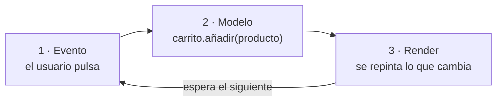
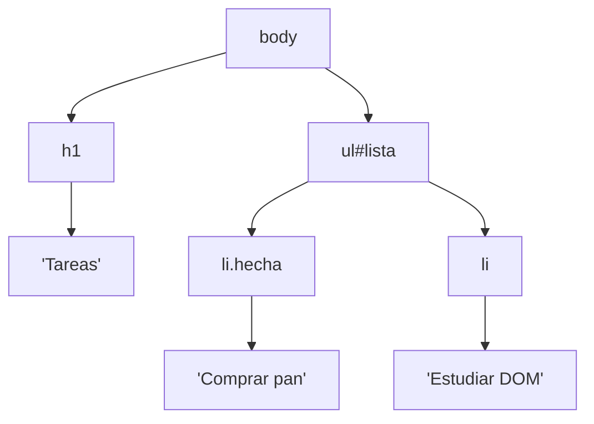
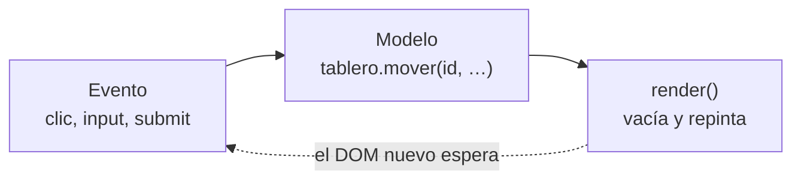
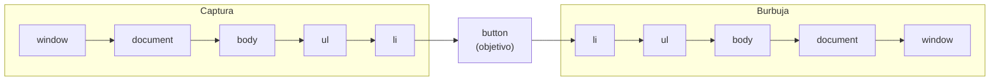

# UD 5: DOM nativo y gestión de eventos (RA4)

<div class="presentacion" markdown>
:material-presentation-play:{ .presentacion__icono } **Presentación de clase** · 57 diapositivas para seguir la unidad

[:material-file-pdf-box: Abrir o descargar el PDF](../assets/presentaciones/DWEC-UD5.pdf){ .md-button .md-button--primary target="_blank" }
</div>

> **Referencia Módulo DWEC:** Resultado de Aprendizaje 4 (RA4), criterios a–d — Manipula el árbol del documento (DOM) desde JavaScript para crear, modificar y eliminar contenido dinámicamente, y gestiona la interacción del usuario mediante el modelo de eventos del navegador (propagación, delegación) y formularios validados.

---

## 1. Dónde estamos: del modelo en memoria a la página que responde :material-map-marker-path:

| Unidad | Qué aprendimos | Qué aporta hoy |
|---|---|---|
| UD3 | Arrays: `map`, `filter`, `find`, `sort` | Convertir colecciones de nodos y pintar listas |
| UD4 | Objetos y clases: el **modelo** | Los datos que la página va a mostrar |
| **UD5 (hoy)** | **DOM y eventos** | **Que el modelo se vea y que el usuario lo cambie** |
| UD6 | Asincronía y almacenamiento | `fetch`, `async/await`, `localStorage` |

La pregunta de la unidad: **¿cómo hago que lo que pasa en mi modelo se vea en la página, y que lo que hace el usuario en la página cambie el modelo?**

Cualquier interfaz repite el mismo ciclo:



!!! info "El DOM no es JavaScript"
    El **DOM** (*Document Object Model*) es un estándar del navegador, del WHATWG. JavaScript es el lenguaje con el que lo manejamos, pero el árbol es el mismo para cualquier herramienta que hable con el navegador. Los frameworks como React (UD7) hacen esto por ti, **sobre el mismo DOM**.

---

## 2. El árbol DOM :material-file-tree:

El navegador lee el HTML y construye un **árbol de objetos**. Cada etiqueta es un **nodo elemento**; el texto que contiene es un **nodo de texto**; anidar etiquetas es la relación **padre → hijos**.

```html
<body>
  <h1>Tareas</h1>
  <ul id="lista">
    <li class="hecha">Comprar pan</li>
    <li>Estudiar DOM</li>
  </ul>
</body>
```



Cambiar uno de esos objetos cambia la página **al momento**, sin recargar. Ojo: lo que cambia es el **árbol en memoria** (lo que ves en DevTools → Elements), no el fichero HTML. Si recargas, el árbol se reconstruye desde el HTML original.

### 2.1. Tipos de nodo

| Tipo | `nodeType` | Ejemplo |
|---|:---:|---|
| Elemento | 1 | `<li>`, `<button>` |
| Texto | 3 | `"Comprar pan"`, **y también los saltos de línea entre etiquetas** |
| Comentario | 8 | `<!-- nota -->` |
| Documento | 9 | `document` |

```javascript
const ul = document.querySelector("#lista");
ul.childNodes.length;    // 5 → texto, li, texto, li, texto
ul.children.length;      // 2 → solo los <li>
ul.firstChild;           // #text "\n    "
ul.firstElementChild;    // <li class="hecha">
```

!!! tip "Usa siempre las versiones *Element*"
    `children`, `firstElementChild`, `lastElementChild`, `nextElementSibling`, `previousElementSibling` y `parentElement` ignoran los nodos de texto. Las versiones sin *Element* (`childNodes`, `firstChild`, `nextSibling`) te devuelven también esos textos invisibles.

### 2.2. `window` y `document`

- **`window`** es el **navegador** (la pestaña) y el objeto global. De él cuelgan `location` (la URL), `history`, `navigator`, `localStorage` (UD6), `console`, `setTimeout`… A todo eso se le llama **BOM** (*Browser Object Model*).
- **`document`** es **la página**: la raíz del DOM. `window.document === document`.

```javascript
window.innerWidth;       // ancho de la ventana
location.href;           // "http://localhost:5173/"
document.title = "Hola"; // cambia el texto de la pestaña
```

!!! note "Módulos y variables globales"
    En un `<script>` clásico, las variables con `var` y las funciones declaradas acaban en `window`. En los **módulos** de Vite no: cada fichero tiene su propio ámbito.

### 2.3. ¿Cuándo está listo el DOM?

`document.querySelector` devuelve **`null`** si el elemento todavía no existe. El navegador lee el HTML de arriba abajo:

| Cómo cargas el script | ¿Cuándo se ejecuta? | ¿Ve el `<body>`? |
|---|---|:---:|
| `<script src>` en `<head>` | En cuanto lo encuentra, parando la lectura | ✗ `null` |
| `<script src>` al final de `<body>` | Al llegar ahí | ✓ |
| `<script defer src>` | Tras leer todo el HTML | ✓ |
| `<script type="module" src>` (Vite) | Diferido, como `defer`, siempre | ✓ |

Los eventos de carga: **`DOMContentLoaded`** (en `document`) salta cuando el árbol está completo; **`load`** (en `window`), cuando además han cargado imágenes y hojas de estilo. Verás mucho código antiguo con:

```javascript
document.addEventListener("DOMContentLoaded", () => iniciar());
```

Con `type="module"` no hace falta, porque el script ya espera al árbol.

!!! warning "«Cannot read properties of null»"
    Si sale al empezar el script, o has buscado el elemento antes de que existiera, o el selector está mal (`"lista"` busca la etiqueta `<lista>`; el id es `"#lista"`).

### 2.4. Moverse por el árbol

```javascript
const li = lista.children[1];        // el 2.º <li>
li.parentElement;                    // <ul id="lista">
li.previousElementSibling;           // el 1.er <li>
li.nextElementSibling;               // el siguiente o null
li.firstElementChild;                // su primer hijo elemento

const btn = li.querySelector("button");
btn.closest("ul");                   // sube hasta el <ul>
btn.closest(".no-existe");           // null
```

**`closest(selector)`** empieza en el propio elemento y **sube** por los padres hasta el primero que cumpla el selector. Es la pieza clave de la delegación de eventos (sección 10).

---

## 3. Seleccionar elementos :material-magnify:

Se usan **los mismos selectores que en CSS**.

| Método | Devuelve | Si no hay ninguno |
|---|---|---|
| `document.querySelector(sel)` | El **primero** que cumple | `null` |
| `document.querySelectorAll(sel)` | Una **NodeList** con todos (estática) | NodeList vacía |
| `document.getElementById(id)` | El elemento con ese id (**sin `#`**) | `null` |
| `elemento.querySelector(sel)` | Busca solo **dentro** de ese elemento | `null` |

```javascript
document.querySelector("#lista");
document.querySelector(".hecha");
document.querySelector("ul > li:last-child");
document.querySelector("[data-id='3']");
document.querySelector("input[name=email]");
lista.querySelectorAll("li.hecha");    // solo dentro de la lista
```

!!! tip "Buenas costumbres"
    - Guarda los elementos en `const` **al arrancar**; no los busques en cada clic.
    - Selecciona por **id, clase o `data-*` propios**, no por la estructura (`div > div > span` se rompe con cualquier cambio del HTML).
    - Si un elemento puede no estar, compruébalo: `boton?.classList.add("activo")`.

### 3.1. NodeList estática frente a HTMLCollection viva

| | `querySelectorAll` → **NodeList estática** | `children`, `getElementsByClassName` → **HTMLCollection viva** |
|---|---|---|
| Si cambia el DOM | No se entera (es una foto) | Se actualiza sola |
| `forEach` | ✓ | ✗ |
| `map`, `filter` | ✗ | ✗ |

```javascript
const fija = document.querySelectorAll("#lista li");
const viva = lista.children;
lista.append(document.createElement("li"));
fija.length;   // 2
viva.length;   // 3

// ¿map o filter? Conviértela en array
const textos = [...document.querySelectorAll("li")].map((li) => li.textContent);
const hechas = Array.from(lista.children).filter((li) => li.classList.contains("hecha"));
```

---

## 4. Leer contenido, atributos y datos :material-text-box-search-outline:

### 4.1. `textContent`, `innerText` e `innerHTML`

```html
<p id="p">Hola <b>Ana</b>
  <span hidden>oculto</span></p>
```

| Propiedad | Devuelve | Con `#p` |
|---|---|---|
| `textContent` | Todo el texto, tal cual (también lo oculto) | `"Hola Ana\n  oculto"` |
| `innerText` | El texto **como se ve** (respeta el CSS; más lento) | `"Hola Ana"` |
| `innerHTML` | El HTML de dentro, como texto | `'Hola <b>Ana</b>\n  <span hidden="">oculto</span>'` |

Para leer y escribir texto, **`textContent`**: es rápido, no interpreta HTML y es seguro (sección 7).

!!! note "Los campos de formulario van aparte"
    Un `<input>` no tiene texto dentro: lo escrito está en **`.value`**, y siempre es un **string**.

### 4.2. Atributos frente a propiedades

El **atributo** es lo escrito en el HTML: cómo **empezó**. La **propiedad** es el valor vivo del objeto: cómo **está ahora**.

```html
<input id="cant" value="1">
```

```javascript
// el usuario borra el 1 y escribe 5
cant.getAttribute("value");   // "1"  (el HTML original)
cant.value;                   // "5"  (lo que hay ahora)
check.checked;                // true / false
enlace.getAttribute("href");  // "/ayuda"
enlace.href;                  // "http://localhost:5173/ayuda" (URL completa)
```

| Para… | Usa |
|---|---|
| El estado actual de un control | `.value`, `.checked`, `.disabled`, `.selected` |
| Atributos propios o de accesibilidad | `setAttribute("aria-expanded", "true")` |
| Quitar o comprobar un atributo | `removeAttribute("hidden")`, `hasAttribute("required")` |

!!! warning "Atributos booleanos"
    `hidden`, `disabled`, `required` o `checked` valen **por existir**, digan lo que digan. `boton.setAttribute("disabled", "false")` **desactiva** el botón. Para activarlo: `boton.disabled = false`.

### 4.3. `dataset`: une el elemento con su dato

Los atributos **`data-*`** son tuyos para guardar información en un elemento. Se leen con **`dataset`**:

```html
<li data-id="42" data-prioridad="alta" data-fecha-limite="2026-11-06">Entregar</li>
```

```javascript
li.dataset.id;            // "42"   ← siempre string
li.dataset.fechaLimite;   // "2026-11-06"  ← guiones → camelCase
Number(li.dataset.id);    // 42
li.dataset.hecha = "si";  // añade data-hecha="si"
delete li.dataset.hecha;  // lo quita
```

!!! success "El patrón de toda la unidad"
    Al **pintar**, guarda el **id del objeto** del modelo en `data-id`. Al **hacer clic**, lee `dataset.id` (convertido a número) y busca el objeto en el modelo. Nunca guardes el objeto entero en el HTML: el modelo es la única fuente de verdad.

### 4.4. `matches` y `closest`

- `el.matches(sel)`: ¿este elemento cumple el selector?
- `el.closest(sel)`: el propio elemento o el antecesor más cercano que lo cumple (o `null`).

```javascript
// el usuario pulsa el ICONO que hay dentro de <button class="borrar"> dentro de <li data-id="7">
const el = e.target;                  // el <svg>
el.matches(".borrar");                // false
el.closest(".borrar");                // <button class="borrar">
el.closest("[data-id]").dataset.id;   // "7"
```

---

## 5. Modificar: clases y estilos :material-palette-outline:

### 5.1. `classList`: el CSS decide el aspecto

| Método | Hace |
|---|---|
| `add("a", "b")` | Añade una o varias clases |
| `remove("a")` | Quita |
| `toggle("a")` | Pone o quita y devuelve el estado |
| `toggle("a", condicion)` | La pone si la condición es verdadera y la quita si es falsa |
| `contains("a")` | ¿La tiene? |
| `replace("a", "b")` | Cambia una por otra |

```css
.tarea.hecha   { text-decoration: line-through; opacity: 0.6; }
.tarea.vencida { border-left: 4px solid var(--rojo); }
```

```javascript
li.textContent = tarea.titulo;
li.classList.toggle("hecha", tarea.hecha);
li.classList.toggle("vencida", tarea.estaVencida());
```

!!! tip "Separar responsabilidades"
    El CSS sabe **cómo** se ve una tarea hecha; el JavaScript solo sabe **cuándo** lo está. Y no uses `className = "…"`: borra todas las clases que había.

### 5.2. `style` y variables CSS

Toca el estilo directamente solo cuando el valor **se calcula** (una posición, un porcentaje):

```javascript
caja.style.backgroundColor = "gold";   // camelCase
caja.style.width = `${porcentaje}%`;   // ¡con unidad!
caja.style.width = 50;                 // sin unidad: se IGNORA (sin error)
caja.style.removeProperty("width");

barra.style.setProperty("--progreso", "75%");   // y en el CSS: width: var(--progreso)
getComputedStyle(caja).display;                // el estilo final, venga de donde venga
```

`el.style` solo lee lo que se puso con `style`, no lo que viene de las hojas CSS: para eso, `getComputedStyle`.

---

## 6. Crear, insertar y borrar nodos :material-plus-box-outline:

### 6.1. `createElement` → configurar → `append`

```javascript
function crearItem(tarea) {
  const li = document.createElement("li");   // 1 · existe en memoria, no en la página
  li.className = "tarea";                    // 2 · configurar
  li.dataset.id = tarea.id;

  const texto = document.createElement("span");
  texto.textContent = tarea.titulo;

  const borrar = document.createElement("button");
  borrar.type = "button";                    // dentro de un form no lo enviará
  borrar.textContent = "Borrar";
  borrar.dataset.accion = "borrar";

  li.append(texto, borrar);
  return li;
}

lista.append(crearItem(tarea));              // 3 · ahora sí se ve
```

Una función que recibe un objeto del modelo y devuelve un nodo es, en la práctica, un **componente** (lo que en React se escribe con JSX).

### 6.2. Dónde se inserta

```javascript
lista.prepend(nuevo);          // primer hijo
lista.append(nuevo);           // último hijo (admite varios nodos y strings)
item.before(nuevo);            // hermano anterior
item.after(nuevo);             // hermano siguiente
item.replaceWith(nuevo);       // lo sustituye
item.remove();                 // lo quita del árbol
lista.replaceChildren();       // vacía la lista
lista.replaceChildren(...nodos); // la vacía y pone estos
```

!!! warning "Un nodo solo está en un sitio"
    Hacer `append` de un nodo que **ya está** en la página lo **mueve**, no lo copia. Para duplicarlo: `nodo.cloneNode(true)` (con sus hijos; los listeners **no** se copian). Mover una tarea de una columna a otra es literalmente `otraColumna.append(li)`.

### 6.3. `<template>`: el HTML en el HTML

```html
<template id="tpl-tarea">
  <li class="tarea">
    <span class="tarea__titulo"></span>
    <time class="tarea__limite"></time>
    <button type="button" data-accion="borrar">Borrar</button>
  </li>
</template>
```

```javascript
const tpl = document.querySelector("#tpl-tarea");

function crearItem(tarea) {
  const li = tpl.content.firstElementChild.cloneNode(true);
  li.dataset.id = tarea.id;
  li.querySelector(".tarea__titulo").textContent = tarea.titulo;
  return li;
}
```

El contenido de un `<template>` es **inerte**: no se muestra, no ejecuta scripts ni carga imágenes. Se clona y se rellena con `textContent`. Así el HTML de la tarjeta se puede cambiar sin tocar el JavaScript.

---

## 7. Seguridad: `innerHTML` y XSS :material-shield-alert-outline:

```javascript
const titulo = input.value;                   // lo escribe el usuario
li.innerHTML = `<span>${titulo}</span>`;      // ✗ el navegador INTERPRETA lo que haya escrito
```

Si el usuario escribe ``, la imagen falla, salta el `onerror` y **su código se ejecuta en tu página**, en la de todas las personas que vean ese dato. Es un ataque **XSS** (*Cross-Site Scripting*): puede leer cookies, cambiar la página o enviar datos a otro sitio.

```javascript
const span = document.createElement("span");
span.textContent = titulo;                    // ✓ se muestra como texto, con sus < y >
li.append(span);
```

| | ¿Con datos del usuario? |
|---|---|
| `textContent`, `createElement`, `<template>` rellenado con `textContent` | ✓ Siempre seguro |
| `innerHTML` con texto **fijo** escrito por ti | ✓ Aceptable |
| `innerHTML` con `${datos}` que vienen de fuera (formulario, API, base de datos) | ✗ XSS |

!!! danger "OWASP Top 10"
    El XSS aparece en **todas** las ediciones del OWASP Top 10, la lista de los riesgos de seguridad web más graves (desde 2021, dentro de la categoría *Injection*). Un `<script>` metido con `innerHTML` no se ejecuta, pero los atributos `on…` (`onerror`, `onload`) sí: por eso el ataque usa una imagen.

---

## 8. Pintar desde el modelo :material-sync:

La arquitectura que vas a usar siempre (y la que usa React):



```javascript
function render() {
  lista.replaceChildren(...tablero.tareas.map(crearItem));
  contador.textContent = `${tablero.pendientes} pendientes`;
}
```

!!! success "La regla"
    **No cambies el DOM «a mano» en los manejadores.** Cambia el **modelo** y llama a `render()`. Si borras con `li.remove()` pero el modelo sigue teniendo la tarea, el siguiente render, un contador o un filtro la vuelven a mostrar. Los datos van en **una sola dirección**: del modelo a la vista.

### 8.1. Rendimiento

Cada cambio en el DOM puede obligar al navegador a **recalcular tamaños** (*reflow*) y **volver a pintar** (*repaint*). Agrupa los cambios:

```javascript
// ✗ 1000 inserciones
for (const t of tareas) lista.append(crearItem(t));

// ✓ un fragmento en memoria y UNA inserción (replaceChildren hace lo mismo)
const frag = document.createDocumentFragment();
for (const t of tareas) frag.append(crearItem(t));
lista.append(frag);
```

- No leas medidas (`offsetHeight`, `getBoundingClientRect`) dentro de un bucle que escribe en el DOM: fuerzas un reflow en cada vuelta (*layout thrashing*).
- Para animar, clases con `transition`/`transform` en el CSS.
- Con decenas de elementos no lo notarás; con miles, sí.

---

## 9. Eventos :material-gesture-tap:

### 9.1. `addEventListener`

```javascript
const boton = document.querySelector("#nueva");

function alPulsar(evento) {
  console.log("pulsado", evento.type);
}

boton.addEventListener("click", alPulsar);     // ✓ se pasa la FUNCIÓN
boton.addEventListener("click", alPulsar());   // ✗ la ejecuta YA y registra undefined (sin error)
```

| Forma | ¿Varios a la vez? | ¿Se usa? |
|---|:---:|---|
| `<button onclick="…">` | ✗ | No: mezcla HTML y JavaScript |
| `boton.onclick = f` | ✗ (el segundo pisa al primero) | Poco |
| `boton.addEventListener("click", f)` | ✓ | Sí, siempre |

Es un **callback**, como los de `map` o `forEach`: el navegador decide cuándo llamarlo y le pasa el **objeto evento**.

### 9.2. El objeto evento

```javascript
boton.addEventListener("click", (e) => {
  e.target;          // dónde OCURRIÓ: lo más profundo (el icono, un span…)
  e.currentTarget;   // quién ESCUCHA: siempre el botón
});

campo.addEventListener("keydown", (e) => {
  e.key;       // "Enter", "a", "Escape", "ArrowUp"
  e.ctrlKey;   // ¿con Control?
});
```

!!! tip "target ≠ currentTarget"
    Si el botón tiene un icono o un `<span>` dentro, el clic puede caer en ellos. Si lees `e.target.dataset` y sale `undefined`, usa `e.currentTarget` o `e.target.closest(...)`.

### 9.3. Los eventos más usados

| Evento | Cuándo salta | Típico para |
|---|---|---|
| `click` | Pulsar (ratón, dedo, o Enter/espacio sobre un botón) | Botones, enlaces |
| `input` | Cada cambio en un campo, al momento | Buscar mientras se escribe |
| `change` | Al confirmar (soltar el select, marcar, salir del campo) | `select`, casillas, radios |
| `submit` | Enviar el formulario | Guardar datos |
| `keydown` | Pulsar una tecla | Atajos, Escape |
| `focusin` / `focusout` | Entrar o salir de un campo (suben por el árbol) | Validar al salir |
| `pointerenter` / `pointerleave` | El puntero entra o sale (no suben) | Tooltips |
| `DOMContentLoaded` | El árbol está listo | Arrancar la app |
| `scroll` / `resize` | Desplazar / cambiar el tamaño (cientos por segundo) | Con cuidado |

---

## 10. Propagación y delegación :material-call-merge:

### 10.1. Captura, objetivo y burbuja

Un clic **viaja** por el árbol: **baja** desde `window` hasta el elemento (**captura**), **llega** (**objetivo**) y **sube** otra vez (**burbuja**).



```javascript
ul.addEventListener("click", () => console.log("ul"));
li.addEventListener("click", () => console.log("li"));
// clic en un botón dentro del li → "li", luego "ul"
```

Por defecto los listeners escuchan en la **burbuja**; con `{ capture: true }` escuchan al bajar. No todos los eventos suben: `focus`, `blur`, `pointerenter` y `pointerleave`, por ejemplo, no.

### 10.2. `preventDefault` frente a `stopPropagation`

| Método | Qué hace | Ejemplo |
|---|---|---|
| `e.preventDefault()` | Cancela la **acción por defecto del navegador** (enviar el formulario y recargar, seguir el enlace, marcar la casilla). El evento sigue subiendo. | `submit` de un formulario |
| `e.stopPropagation()` | Detiene **el viaje**: los padres no se enteran. El navegador sí hace su acción. | Úsalo poco: rompe la delegación y la analítica |

```javascript
form.addEventListener("submit", (e) => {
  e.preventDefault();          // ¡que no recargue!
  guardar(new FormData(form));
});
```

!!! warning "El fallo n.º 1 de los formularios"
    Olvidar `preventDefault` en el `submit`: la página se recarga, la consola se borra y parece que «no hace nada».

### 10.3. Delegación de eventos

En vez de un listener en cada botón de cada elemento, **uno solo en el padre**. Gracias a la burbuja, el padre se entera de los clics en todos sus hijos, **también en los que se añadan después**.

```javascript
lista.addEventListener("click", (e) => {
  const boton = e.target.closest("[data-accion]");
  if (!boton) return;                                  // clic en otro sitio

  const id = Number(boton.closest("li").dataset.id);   // ¿qué objeto?
  const accion = boton.dataset.accion;                 // ¿qué hacer?

  if (accion === "borrar") tablero.borrar(id);
  if (accion === "hecha") tablero.completar(id);
  render();
});
```

Ventajas: **un** listener en vez de cientos, sirve para los elementos que pintes después y no se duplica al repintar.

### 10.4. Listeners duplicados

```javascript
function render() {
  lista.replaceChildren(...items);
  nuevaBtn.addEventListener("click", () => crear());   // ✗ una flecha NUEVA en cada render
}
// 3 renders → 1 clic crea 3 tareas
```

- Añadir **la misma función** dos veces al mismo evento se ignora; cada **flecha nueva** es otra función, y esas sí se acumulan.
- Los listeners se ponen **una vez, al arrancar**, fuera de `render()`. Para los hijos que se repintan, delegación.
- `removeEventListener` necesita **la misma referencia** (con una flecha nueva no quita nada). `{ once: true }` lo quita tras la primera vez, y con un `AbortController` (`{ signal }`) puedes quitar varios de golpe.

---

## 11. `this`, teclado, accesibilidad y eventos propios :material-keyboard-outline:

### 11.1. `this` en los manejadores

| Manejador | `this` dentro |
|---|---|
| `function () { … }` | El elemento (`currentTarget`) |
| `() => { … }` | El `this` de fuera |
| `obj.metodo` (pasado sin llamar) | El elemento: **se pierde `obj`** |
| `() => obj.metodo()` o `obj.metodo.bind(obj)` | `obj` ✓ |

```javascript
class Contador {
  #valor = 0;
  constructor(boton, salida) {
    this.salida = salida;
    // ✗ boton.addEventListener("click", this.sumar);  → this sería el botón
    boton.addEventListener("click", () => this.sumar());
  }
  sumar() {
    this.#valor++;
    this.salida.textContent = this.#valor;
  }
}
```

Si te sale `TypeError: Cannot read private member #valor from an object whose class did not declare it`, significa que `this` no es un `Contador`: es el `this` perdido de la UD4.

### 11.2. Si se puede pulsar, que sea un `<button>`

Un `<div class="btn">` con `click` **no** recibe el foco con Tab, **no** reacciona a Enter ni a espacio y el lector de pantalla no dice «botón». Un **`<button type="button">`** trae todo eso de serie (`type="button"` para que dentro de un formulario no lo envíe).

```javascript
document.addEventListener("keydown", (e) => {
  if (e.key === "Escape") cerrarModal();
  if (e.key === "n" && e.ctrlKey) {
    e.preventDefault();
    nuevaTarea();
  }
});
```

Prueba de fuego: **desenchufa el ratón**. ¿Puedes usar toda la aplicación con Tab, Enter y Escape? ¿Se ve dónde está el foco (`:focus-visible`)? Al abrir algo, mueve el foco con `elemento.focus()`.

### 11.3. Eventos personalizados

```javascript
// quien avisa
item.dispatchEvent(new CustomEvent("tarea-completada", {
  detail: { id: 7, titulo: "Entregar" },
  bubbles: true,             // sin esto no subiría hasta document
}));

// quien escucha, sin conocer a quien avisa
document.addEventListener("tarea-completada", (e) => {
  mostrarAviso(`¡Hecho: ${e.detail.titulo}!`);
});
```

Sirven para **desacoplar** partes de la aplicación; los Web Components se comunican así.

---

## 12. Formularios :material-form-select:

### 12.1. Leer un formulario

```html
<form id="alta">
  <input name="titulo" required>
  <select name="prioridad">
    <option>baja</option>
    <option selected>media</option>
  </select>
  <input name="horas" type="number">
  <button>Añadir</button>
</form>
```

```javascript
form.addEventListener("submit", (e) => {
  e.preventDefault();
  const datos = Object.fromEntries(new FormData(form));
  // { titulo: "…", prioridad: "media", horas: "3" }
  datos.horas = Number(datos.horas);
  tablero.crearTarea(datos);
  form.reset();
  render();
});
```

- **`FormData`** usa el atributo **`name`**: un campo sin `name` no sale.
- **Todo llega como string**. Las casillas sin marcar **no aparecen**.
- Escucha **`submit` en el formulario**, no `click` en el botón: así funciona también al pulsar **Enter** en un campo (si el formulario tiene botón de envío o un solo campo).
- `form.elements.titulo` da el campo por su `name`; `form.reset()` lo deja como al cargar.

### 12.2. `input`, `change` y `submit`

| Evento | Salta… | Úsalo para |
|---|---|---|
| `input` | A cada cambio | Filtros en vivo, contadores de caracteres |
| `change` | Al confirmar (en casillas y radios, al marcar) | `select`, casillas, validar al salir |
| `submit` | Al enviar | Guardar, siempre con `preventDefault` |

```javascript
buscador.addEventListener("input", () => {
  filtro = buscador.value.trim().toLowerCase();
  render();
});
```

En casillas y radios, el estado está en **`.checked`**, no en `.value`.

### 12.3. Validación nativa

| Atributo | Comprueba |
|---|---|
| `required` | Que no esté vacío |
| `type="email"`, `type="url"` | El formato |
| `minlength`, `maxlength` | La longitud |
| `min`, `max`, `step` | Rango de números o fechas |
| `pattern` | Una expresión regular que cumpla **todo** el valor |

Sin JavaScript, el navegador no deja enviar el formulario si algo falla. Con **`novalidate`** en el `<form>` quitas sus globos para mostrar tus mensajes, pero los atributos siguen funcionando. En el CSS, **`:user-invalid`** marca el campo solo cuando el usuario ya lo ha tocado (mejor que `:invalid`, que lo marca desde que carga).

### 12.4. Constraint Validation API

| `campo.validity.` | `true` si… |
|---|---|
| `valueMissing` | Es `required` y está vacío |
| `typeMismatch` | No parece un email / URL |
| `tooShort` / `tooLong` | No cumple `minlength` / `maxlength` (**solo con lo que escribe el usuario**) |
| `rangeUnderflow` / `rangeOverflow` | Fuera de `min` / `max` |
| `patternMismatch` | No cumple `pattern` |
| `customError` | Hay un mensaje de `setCustomValidity` |
| `valid` | Todo bien |

```javascript
function validarTitulo() {
  const t = form.elements.titulo;
  if (t.validity.valueMissing) {
    t.setCustomValidity("Escribe un título");
  } else if (tablero.existe(t.value.trim())) {
    t.setCustomValidity("Ya hay una tarea así");   // esto el HTML no lo puede saber
  } else {
    t.setCustomValidity("");                        // ← imprescindible: quita el error
  }
  return t.checkValidity();
}
form.elements.titulo.addEventListener("input", validarTitulo);
```

!!! warning "`setCustomValidity("")`"
    Si no la llamas, el campo se queda inválido para siempre.

### 12.5. Mostrar los errores bien

- Junto al campo, con **borde + icono + texto**: el color solo no basta.
- Une el campo con su mensaje y haz que se anuncie:

```html
<label for="titulo">Título</label>
<input id="titulo" name="titulo" required minlength="3" aria-describedby="err-titulo">
<p id="err-titulo" class="error" aria-live="polite"></p>
```

```javascript
function mostrarError(campo, mensaje) {
  campo.setAttribute("aria-invalid", mensaje ? "true" : "false");
  document.querySelector(`#err-${campo.name}`).textContent = mensaje;
}
```

- Al enviar con errores, pon el **foco en el primer campo con error**.

### 12.6. Validar en el cliente no es seguridad

La validación del navegador es **comodidad** para el usuario. Cualquiera puede quitar el `required` en DevTools o enviar la petición sin pasar por tu formulario. **El servidor tiene que volver a validarlo todo** (lo verás con `fetch` en la UD6). Nunca confíes en un precio, un rol o un id que venga del navegador, ni en `hidden` o `disabled`.

---

## 13. Verificar: DevTools :material-bug-check-outline:

| Herramienta | Para qué |
|---|---|
| **Elements** | El árbol **real** (no el HTML original). Se puede editar a mano para probar |
| `$0` (consola) | El último elemento seleccionado en Elements |
| **Event Listeners** (pestaña en Elements) | Qué escucha cada nodo y en qué línea de tu código |
| **Break on → subtree modifications** | Pausa cuando algo cambia ese nodo: «¿quién me borra la lista?» |
| `getEventListeners($0)` | Los listeners del elemento (solo en la consola de Chrome) |
| `monitorEvents($0, "click")` | Imprime cada evento que recibe |
| `$$("a")` | `querySelectorAll` como array (solo en la consola) |

Si en **Event Listeners** ves tres `click` en el mismo botón, tienes el problema de los listeners duplicados (10.4).

---

## 14. Errores comunes :material-alert-circle-outline:

| Error | Síntoma | Arreglo |
|---|---|---|
| `querySelector("lista")` | `null` | `querySelector("#lista")` |
| Script en `<head>` sin `defer` | `null` al arrancar | `type="module"`, `defer` o al final del `body` |
| `li.innerHTML = tarea.titulo` | XSS | `li.textContent = tarea.titulo` |
| `querySelectorAll(…).map(…)` | `map is not a function` | `[...querySelectorAll(…)].map(…)` |
| `dataset.id === 7` | Nunca coincide | `Number(dataset.id) === 7` |
| `addEventListener("click", crear())` | No hace nada (sin error) | `addEventListener("click", crear)` |
| Sin `preventDefault` en `submit` | La página se recarga | `e.preventDefault()` lo primero |
| Listener dentro de `render()` | Cada clic cuenta varias veces | Una vez al arrancar, o delegación |
| `e.target.dataset.id` con un icono dentro | `undefined` | `e.target.closest("[data-id]")` |
| `setCustomValidity("Error")` sin limpiar | El campo no vuelve a ser válido | `setCustomValidity(mal ? "Error" : "")` |
| `setAttribute("disabled", "false")` | Se desactiva | `boton.disabled = false` |
| `<div>` con `click` como botón | No se usa con teclado | `<button type="button">` |

---

## 15. Ejercicio práctico guiado: agenda de contactos :material-clipboard-check:

Proyecto Vite en Docker (como la UD4) con esta estructura:

```text
index.html              form#alta · input#buscar · p#contador · ul#contactos · template#tpl-contacto
src/modelo/Contacto.js  nombre y email validados en los setters · favorito · alternarFavorito() · coincide(texto)
src/modelo/Agenda.js    #contactos · añadir(datos) · borrar(id) · alternarFavorito(id) · buscar(texto) · get total
src/vista/render.js     crearItem(contacto) con el template · render(lista, contador, contactos, total)
src/main.js             los listeners, UNA vez → agenda → render
```

1. **Modelo** (`Contacto`, `Agenda`): el nombre con al menos 2 letras y el email con formato válido (si no, el constructor lanza). `Agenda.añadir` no admite dos contactos con el mismo email. `buscar(texto)` devuelve los que coinciden, **favoritos primero** y luego por nombre.
2. **Pintar** con el `<template>`: nombre, email (como enlace `mailto:`), un botón ★ con `aria-pressed` y otro de borrar. Contador «1 contacto» / «N contactos» / «2 de 9 contactos» cuando hay filtro.
3. **Alta**: formulario con `novalidate`, errores junto a cada campo (`validity` + `aria-invalid` + `aria-describedby`), foco en el primer error y el error del email repetido que viene del modelo.
4. **Acciones**: favorito y borrar con **un único listener** en la lista (delegación).
5. **Filtro**: `input` en el buscador; Escape lo vacía.

!!! success "Criterio de éxito"
    Alta validada sin recargar; borrar y favorito con un único listener; filtro en vivo; ningún listener duplicado tras 10 altas (compruébalo en **Event Listeners**); y un contacto llamado `` se muestra como texto.

!!! tip "Si terminas"
    Un `<select>` para ordenar (favoritos primero / alfabético) con el evento `change`.

---

## 16. Comprueba lo aprendido :material-head-question-outline:

??? question "1. `ul.childNodes.length` da 5 si solo hay dos `<li>`. ¿Por qué? ¿Qué usarías?"
    Los saltos de línea y espacios entre etiquetas son **nodos de texto**: texto, `li`, texto, `li`, texto. Para contar solo elementos, `ul.children.length` (2).

??? question "2. Un `<input value="1">` en el que el usuario escribe 5: ¿qué dan `getAttribute("value")` y `.value`?"
    `"1"` y `"5"`. El atributo es el HTML original; la propiedad, el valor actual. Los dos son strings.

??? question "3. Clic en el `<svg>` de un botón que tiene un listener. ¿Qué son `e.target` y `e.currentTarget`?"
    `e.target` es el `svg` (donde ocurrió el clic); `e.currentTarget` es el botón (quien escucha).

??? question "4. ¿Por qué la delegación funciona con los `<li>` que se añaden después?"
    Porque el listener está en el **padre**, que no cambia, y el clic de cualquier hijo **sube** hasta él por la burbuja. En el manejador se averigua con `closest` qué hijo se pulsó.

??? question "5. `li.innerHTML = `<b>${titulo}</b>`` con el título que escribe el usuario: ¿qué riesgo hay y cómo lo arreglas?"
    **XSS**: si escribe HTML con un atributo `onerror`, su código se ejecuta. Arreglo: `const b = document.createElement("b"); b.textContent = titulo; li.replaceChildren(b);`.

??? question "6. ¿Qué diferencia hay entre `preventDefault` y `stopPropagation`?"
    `preventDefault` cancela la acción por defecto del navegador (enviar y recargar, seguir el enlace…), pero el evento sigue subiendo. `stopPropagation` detiene el viaje del evento hacia los padres, pero el navegador sí hace su acción.

??? question "7. ¿Qué imprime este código?"
    ```javascript
    let n = 0;
    const f = () => n++;
    boton.addEventListener("click", f);
    boton.addEventListener("click", f);
    boton.addEventListener("click", () => n++);
    boton.click();
    console.log(n);
    ```
    `2`. La misma función añadida dos veces cuenta como una; la flecha es otra función.

??? question "8. ¿Qué devuelve `Object.fromEntries(new FormData(form)).horas` si el campo tiene `value="3"`? ¿Y `"urgente" in datos` con una casilla `urgente` sin marcar?"
    `"3"` (string: hay que convertirlo con `Number`) y `false`: las casillas sin marcar no se envían.

??? question "9. ¿Por qué hay que llamar a `setCustomValidity("")`?"
    Porque un mensaje puesto con `setCustomValidity` deja el campo inválido hasta que se quita con la cadena vacía.

??? question "10. ¿Por qué no basta con validar en el navegador?"
    Porque el usuario controla todo lo que pasa en el navegador: puede quitar los atributos en DevTools o enviar la petición directamente. La validación del cliente es para ayudar; la que protege es la del servidor.

---

## 17. Glosario :material-book-alphabet:

| Término | Definición |
|---|---|
| **DOM** | Representación del documento como árbol de objetos que se puede leer y modificar con código |
| **Nodo** | Cada pieza del árbol: elemento, texto, comentario o el documento |
| **Elemento** | Nodo que corresponde a una etiqueta HTML |
| **`window` / BOM** | El navegador y lo que ofrece además de la página (`location`, `history`, `localStorage`…) |
| **`DOMContentLoaded`** | Evento que indica que el árbol está construido |
| **NodeList** | Lista de nodos; la de `querySelectorAll` es estática |
| **HTMLCollection** | Lista de elementos que se actualiza sola (`children`) |
| **Atributo / propiedad** | Lo escrito en el HTML / el valor vivo del objeto DOM |
| **`dataset`** | Acceso a los atributos `data-*` (camelCase, siempre string) |
| **`textContent`** | Texto de un nodo; asignarlo no interpreta HTML |
| **XSS** | Inyección de código que se ejecuta en la página de otros a través de datos sin escapar |
| **`<template>`** | HTML inerte que se clona y se rellena desde JavaScript |
| **Render** | Generar el DOM a partir del modelo |
| **Reflow / repaint** | Recalcular la geometría / volver a pintar la página |
| **Evento** | Algo que ocurre: un clic, una tecla, el envío de un formulario… |
| **Listener (manejador)** | Función que se ejecuta cuando ocurre un evento |
| **`target` / `currentTarget`** | Elemento donde ocurrió el evento / elemento cuyo listener se ejecuta |
| **Propagación** | Recorrido del evento: captura → objetivo → burbuja |
| **Delegación** | Un listener en el padre para gestionar los eventos de todos sus hijos |
| **`preventDefault`** | Cancela la acción por defecto del navegador |
| **`stopPropagation`** | Detiene la propagación del evento |
| **`FormData`** | Los campos de un formulario por su `name` |
| **Constraint Validation API** | `validity`, `checkValidity`, `setCustomValidity`… |
| **`aria-live`** | Región cuyos cambios anuncia el lector de pantalla |

---

## 18. Resumen y conexión con la siguiente unidad :material-link-variant:

- La página es un **árbol de objetos**: el DOM. `document` es su raíz; `window`, el navegador.
- **`querySelector`**, **`closest`** y **`dataset`** encuentran elementos y los conectan con el modelo.
- **`textContent`**, **`createElement`** y **`<template>`** pintan sin riesgo; **`innerHTML` nunca con datos del usuario**.
- **Evento → modelo → `render()`**, con los listeners puestos **una sola vez** y **delegación** en el padre.
- Formularios: **`submit` + `preventDefault` + `FormData`**, validación nativa, `validity` y errores accesibles. Y el servidor vuelve a validar.

**Siguiente: UD6 · Asincronía y almacenamiento.** El modelo ya se ve y responde, pero se pierde al recargar y no habla con ningún servidor. En la UD6: el *event loop*, promesas y `async/await`, `fetch` contra una API, y `localStorage` para que los datos se recuerden.

---

## 19. Referencias y fuentes :material-book-open-page-variant:

- MDN Web Docs — [Introducción al DOM](https://developer.mozilla.org/es/docs/Web/API/Document_Object_Model/Introduction), [`Element`](https://developer.mozilla.org/es/docs/Web/API/Element), [Introducción a los eventos](https://developer.mozilla.org/es/docs/Learn_web_development/Core/Scripting/Events), [`EventTarget.addEventListener`](https://developer.mozilla.org/es/docs/Web/API/EventTarget/addEventListener).
- MDN — [Validación de formularios en el cliente](https://developer.mozilla.org/es/docs/Learn_web_development/Extensions/Forms/Form_validation) y [Constraint Validation API](https://developer.mozilla.org/en-US/docs/Web/HTML/Guides/Constraint_validation).
- WHATWG — [DOM Standard](https://dom.spec.whatwg.org/) y [HTML Standard: el elemento `template`](https://html.spec.whatwg.org/multipage/scripting.html#the-template-element).
- OWASP — [Cross Site Scripting (XSS)](https://owasp.org/www-community/attacks/xss/) y [XSS Prevention Cheat Sheet](https://cheatsheetseries.owasp.org/cheatsheets/Cross_Site_Scripting_Prevention_Cheat_Sheet.html).
- W3C WAI — [ARIA Authoring Practices: patrón de pestañas](https://www.w3.org/WAI/ARIA/apg/patterns/tabs/).
- web.dev — [Evita diseños grandes y complejos, y el *layout thrashing*](https://web.dev/articles/avoid-large-complex-layouts-and-layout-thrashing).
