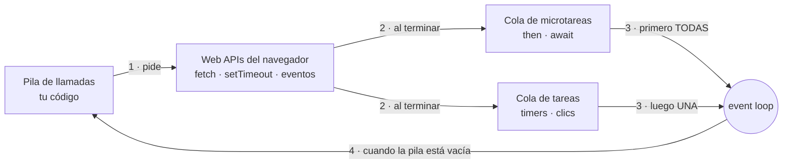
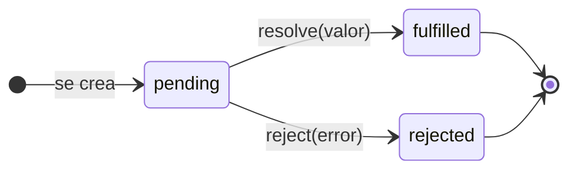
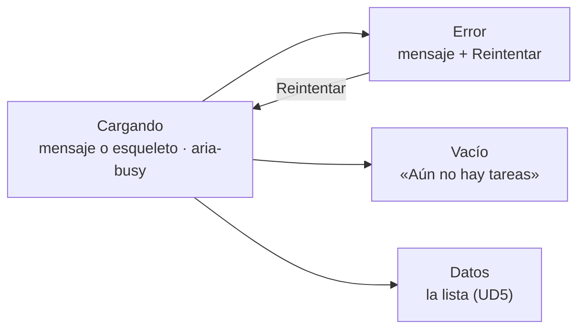

# UD 6: Asincronía y almacenamiento (Storage/Vite) (RA4)

<div class="presentacion" markdown>
:material-presentation-play:{ .presentacion__icono } **Presentación de clase** · 57 diapositivas para seguir la unidad

[:material-file-pdf-box: Abrir o descargar el PDF](../assets/presentaciones/DWEC-UD6.pdf){ .md-button .md-button--primary target="_blank" }
</div>

> **Referencia Módulo DWEC:** Resultado de Aprendizaje 4 (RA4), criterios e–i — Desarrolla aplicaciones web que se comunican de forma asíncrona con servidores (promesas, `async/await`, API Fetch), gestiona el almacenamiento de datos en el cliente (`localStorage`, `sessionStorage`) y utiliza herramientas de construcción (Vite) y módulos para organizar y desplegar el proyecto.

---

## 1. Dónde estamos: la aplicación ya se ve; ahora tiene que recordar y hablar con el servidor :material-map-marker-path:

| Unidad | Qué aprendimos | Qué aporta hoy |
|---|---|---|
| UD4 | Objetos y clases: el **modelo** | Lo que hay que guardar y reconstruir |
| UD5 | DOM y eventos | Pintar los datos que lleguen de la red |
| **UD6 (hoy)** | **Asincronía y almacenamiento** | **Pedir datos sin congelar la página y recordarlos al recargar** |
| UD7 | React | Lo mismo, con un framework |

La pregunta de la unidad: **¿cómo pido datos a un servidor sin congelar la página, y cómo hago que mi aplicación se acuerde de todo al recargar?**

!!! info "Diseña para cuando las cosas van mal"
    Un buen frontend se nota sobre todo cuando la red es lenta, cuando no hay conexión o cuando el servidor responde con un error. Esta unidad trata tanto del caso feliz como de esos tres.

---

## 2. El modelo de ejecución :material-sync:

### 2.1. Un solo hilo

JavaScript, en el navegador, hace **una cosa a la vez**: tiene una sola **pila de llamadas**, y mientras tu código se ejecuta el navegador no puede pintar ni atender un clic.

```javascript
// ✗ un bucle de 3 s congela la página entera (ni clics, ni scroll)
const fin = Date.now() + 3000;
while (Date.now() < fin) {}

// ✓ «avísame dentro de 3 s» y seguir
setTimeout(() => console.log("ya"), 3000);
```

Por eso lo lento (la red, los temporizadores, los archivos) **no se espera**: se **pide**, y el resultado llega **más tarde**. Asíncrono no significa «en paralelo»: tu código sigue siendo de un hilo; lo que va aparte es **la espera**, y la hace el navegador.

### 2.2. El event loop



1. Tu código pide algo al navegador (las **Web APIs**: `fetch`, `setTimeout`, `addEventListener`) y **sigue**.
2. Cuando termina, el navegador deja el callback en una **cola**: la de **microtareas** (`then`, lo que va después de un `await`) o la de **tareas** (temporizadores, eventos como el clic).
3. El **event loop** espera a que la pila esté vacía; entonces ejecuta **todas** las microtareas y después **una** tarea, pinta si toca y vuelve a empezar.

### 2.3. Temporizadores

```javascript
const id = setTimeout(() => console.log("una vez, dentro de 1 s"), 1000);
clearTimeout(id);                                  // cancelado

const reloj = setInterval(() => pintarHora(new Date()), 1000);
clearInterval(reloj);                              // parar
```

- Los milisegundos son un **mínimo**, no un tiempo exacto: si la pila está ocupada, el callback espera. Las pestañas en segundo plano se ralentizan.
- `setTimeout(f, 0)` no es «ya», sino «cuando la pila esté vacía».
- Para medir tiempo de verdad, compara con **`Date.now()`**, no cuentes ticks.

### 2.4. Microtareas frente a tareas

```javascript
console.log("1 · síncrono");
setTimeout(() => console.log("2 · tarea"), 0);
Promise.resolve().then(() => console.log("3 · microtarea"));
console.log("4 · síncrono");
// 1 · síncrono
// 4 · síncrono
// 3 · microtarea
// 2 · tarea
```

**La regla:** primero todo el código síncrono; luego **todas** las microtareas; y solo entonces la siguiente tarea.

### 2.5. Callbacks y el *callback hell*

Antes de las promesas, encadenar operaciones asíncronas era anidar callbacks:

```javascript
obtenerUsuario(id, (err, usuario) => {
  if (err) return mostrarError(err);
  obtenerTablero(usuario.tablero, (err, tablero) => {
    if (err) return mostrarError(err);
    obtenerTareas(tablero.id, (err, tareas) => {
      if (err) return mostrarError(err);
      render(tareas);
    });
  });
});
```

Una pirámide difícil de leer, con un `if (err)` en cada nivel. Los callbacks siguen existiendo (`addEventListener`, `setTimeout`), pero para **encadenar** se usan promesas y `async/await`.

---

## 3. Promesas :material-timer-sand:

### 3.1. ¿Qué es una promesa?

Un objeto que representa **un resultado que todavía no está**. Como el tique de la cafetería: no tienes el café, pero tienes algo que te avisará cuando esté (o de que se ha acabado la leche).



Una promesa empieza **pendiente** y acaba **cumplida** (con un valor) o **rechazada** (con un error). Una vez resuelta, **no cambia nunca**.

### 3.2. Crear una promesa

```javascript
// convertir setTimeout en una promesa
function esperar(ms) {
  return new Promise((resolve) => setTimeout(resolve, ms));
}

function tirarDado() {
  return new Promise((resolve, reject) => {
    const n = Math.ceil(Math.random() * 6);
    n === 1 ? reject(new Error("¡Un 1!")) : resolve(n);
  });
}
```

La función de dentro (el **ejecutor**) se ejecuta enseguida. Casi nunca escribirás `new Promise`: `fetch` y las APIs modernas ya devuelven promesas.

### 3.3. `then`, `catch` y `finally`

```javascript
mostrarCargando(true);
tirarDado()
  .then((n) => console.log("Has sacado", n))
  .catch((error) => console.warn(error.message))
  .finally(() => mostrarCargando(false));

console.log("Esto sale ANTES que el dado");
```

`then` solo **registra** qué hacer: el código sigue y el `then` se ejecuta después, como microtarea.

### 3.4. Encadenar: lo que devuelves es lo que recibe el siguiente

```javascript
fetch("/api/usuario")
  .then((r) => r.json())                            // devuelve una promesa: se espera
  .then((u) => fetch(`/api/tableros/${u.tablero}`))
  .then((r) => r.json())
  .then((tablero) => render(tablero))
  .catch((e) => mostrarError(e));                   // el error de CUALQUIER paso
```

!!! warning "El error n.º 1: un `then` con llaves y sin `return`"
    `.then((r) => { r.json(); })` no devuelve nada: el siguiente `then` recibe `undefined` y no hay ningún error. Con llaves, `return`; sin llaves, el `return` es implícito: `.then((r) => r.json())`.

### 3.5. Varias promesas a la vez

| Método | Se cumple cuando… | Se rechaza cuando… | Para |
|---|---|---|---|
| `Promise.all([…])` | **Todas** se cumplen (array de valores, en el orden del array) | La **primera** falla | Cargar varias cosas que hacen falta todas |
| `Promise.allSettled([…])` | Todas terminan, bien o mal (`[{ status, value \| reason }]`) | Nunca | Saber qué ha ido bien y qué no |
| `Promise.race([…])` | La primera que **termine** | Si la primera en terminar falla | Tiempo límite |
| `Promise.any([…])` | La primera que **se cumpla** | Fallan todas (`AggregateError`) | Servidores espejo |

```javascript
const [usuario, tareas] = await Promise.all([getJSON("/api/usuario"), getJSON("/api/tareas")]);
```

### 3.6. Errores en las promesas

```javascript
Promise.resolve(5)
  .then((n) => { throw new Error("falla en " + n); })   // rechaza la cadena
  .then(() => console.log("no se ejecuta"))
  .catch((e) => { console.warn(e.message); return 0; }) // RECUPERA
  .then((n) => console.log("sigue con", n));            // sigue con 0
```

- Un `throw` dentro de un `then` salta al siguiente `catch`; lo que devuelve `catch` sigue la cadena como cumplido.
- Un rechazo que nadie captura sale en la consola como **`Uncaught (in promise)`**: el error se pierde y la interfaz se queda colgada. **Toda cadena termina en `catch`** (o en `try/catch` con `await`).
- Un `try/catch` normal **no** captura el error de una promesa que no esperas: `try { fetch(url) } catch {}` no ve nada.

---

## 4. `async` / `await` :material-fast-forward:

### 4.1. Promesas, leídas de arriba abajo

```javascript
async function cargar() {
  const r = await fetch("/datos/tareas.json");
  const tareas = await r.json();
  render(tareas);
  return tareas.length;
}
```

- **`async`**: la función devuelve **siempre una promesa**; su `return` es el valor con el que se cumple.
- **`await`**: pausa **esa función** hasta que la promesa se resuelva y da su valor. **No congela la página**: mientras espera, el event loop sigue atendiendo eventos y pintando.
- Se usa dentro de funciones `async` o en el **nivel superior de un módulo**.

### 4.2. Errores con `try / catch / finally`

```javascript
async function cargarTareas() {
  estado.textContent = "Cargando…";
  boton.disabled = true;
  try {
    const tareas = await getJSON("/datos/tareas.json");
    render(tareas);
    estado.textContent = "";
  } catch (error) {
    estado.textContent = `Error: ${error.message}`;
  } finally {
    boton.disabled = false;   // pase lo que pase
  }
}
```

Pon el `try` donde sepas qué hacer con el error (normalmente, en la interfaz). Las funciones de bajo nivel, como `getJSON`, **lanzan**; la interfaz **decide**.

### 4.3. En serie o en paralelo

```javascript
// ≈ 1,5 s: la segunda espera a la primera
const u = await getJSON("/api/usuario");   // 1 s
const t = await getJSON("/api/tareas");    // 0,5 s

// ≈ 1 s: las dos a la vez
const [u2, t2] = await Promise.all([getJSON("/api/usuario"), getJSON("/api/tareas")]);
```

En serie, solo si la segunda petición **necesita** el resultado de la primera. Si son independientes, `Promise.all`.

### 4.4. Trampas

| Trampa | Qué pasa | Arreglo |
|---|---|---|
| Olvidar `await` | Tienes una `Promise`, no el valor (`datos.length` → `undefined`) | `const datos = await getJSON(url);` |
| `await` dentro de `forEach` | `forEach` no espera: termina enseguida y los errores se pierden | `for (const t of tareas) await guardar(t);` o `await Promise.all(tareas.map(guardar));` |
| Llamar a una función `async` sin `await` ni `.catch` | `Uncaught (in promise)` | `cargar().catch(mostrarError);` |

!!! tip "Consola de Chrome"
    En la consola de DevTools puedes escribir `await` directamente. En tus ficheros, solo dentro de funciones `async` o en el nivel superior de un módulo.

---

## 5. HTTP y JSON :material-swap-horizontal:

### 5.1. HTTP en un vistazo

Una **petición** lleva un **método**, una URL, **cabeceras** y, a veces, un **cuerpo**. La **respuesta** trae un **código de estado**, cabeceras y cuerpo.

```http
POST /api/tareas HTTP/1.1
Content-Type: application/json

{"titulo":"Entregar","prioridad":"alta"}
```

```http
HTTP/1.1 201 Created
Content-Type: application/json

{"id":42,"titulo":"Entregar","prioridad":"alta"}
```

| Método | Para | | Código | Significa |
|---|---|---|---|---|
| `GET` | Leer | | `200` · `201` · `204` | OK · creado · OK sin cuerpo |
| `POST` | Crear | | `400` · `401` · `403` | Datos mal · sin sesión · sin permiso |
| `PUT` · `PATCH` | Reemplazar · cambiar | | `404` | No existe |
| `DELETE` | Borrar | | `500` · `503` | Fallo del servidor · no disponible |

**2xx** = bien · **4xx** = la culpa es de la petición · **5xx** = la culpa es del servidor.

### 5.2. JSON

```javascript
const texto = JSON.stringify({ id: 1, titulo: "A", hecha: false });
// '{"id":1,"titulo":"A","hecha":false}'
const obj = JSON.parse(texto);
JSON.parse("{titulo: 'A'}");   // SyntaxError: claves sin comillas dobles
```

| Valor en JavaScript | En JSON | Al volver con `parse` |
|---|---|---|
| `string`, `number`, `boolean`, `null`, arrays, objetos | Igual | Igual |
| `Date` | `"2026-11-20T08:00:00.000Z"` | **Un string** |
| `undefined`, funciones | Desaparecen (dentro de un array, `null`) | — |
| Instancia de una clase | Solo sus propiedades **públicas** | Objeto normal, sin métodos ni `#privados` |
| `NaN`, `Infinity` | `null` | `null` |

Reglas del formato: claves **siempre** entre comillas dobles, sin comillas simples, sin comas finales, sin comentarios.

---

## 6. `fetch`: hablar con una API :material-api:

### 6.1. Pedir datos

```javascript
const respuesta = await fetch("/datos/tareas.json");  // se cumple al llegar las CABECERAS
respuesta.ok;                                          // true si el código es 200–299
respuesta.status;                                      // 200
respuesta.headers.get("Content-Type");                 // "application/json"
const tareas = await respuesta.json();                 // lee el CUERPO y lo parsea
```

- Dos `await`: uno para la respuesta y otro para el cuerpo. Para texto, `r.text()`; para archivos, `r.blob()`.
- El cuerpo **solo se lee una vez**: un segundo `r.json()` lanza `TypeError: … body stream already read`.
- En Vite, lo que hay en **`public/`** se sirve en la raíz: `public/datos/tareas.json` → `fetch("/datos/tareas.json")`.

### 6.2. `fetch` no falla con un 404

| Qué pasa | ¿`fetch` rechaza? | `respuesta.ok` |
|---|---|---|
| 200 OK | No | `true` |
| 404 No existe · 500 Error del servidor | **No** | `false` |
| Sin conexión, servidor caído, bloqueado por CORS | Sí: `TypeError: Failed to fetch` | — |

`fetch` solo rechaza cuando **no hay respuesta**. Los errores HTTP son respuestas «normales»: los tienes que convertir tú en error. Hazlo en **una sola función** que use todo el proyecto:

```javascript
export async function getJSON(url, { signal } = {}) {
  const r = await fetch(url, { signal });
  if (!r.ok) throw new Error(`HTTP ${r.status} en ${url}`);
  const tipo = r.headers.get("Content-Type") ?? "";
  if (!tipo.includes("json")) throw new Error(`${url} no es JSON`);
  return r.json();
}
```

!!! warning "En el servidor de desarrollo de Vite no hay 404"
    Con `npm run dev`, un fichero que no existe responde **200 con el `index.html`** (Vite está pensado para aplicaciones de una sola página). Sin comprobar el `Content-Type`, el fallo llega en `r.json()` como `SyntaxError: Unexpected token '<'…`, que no dice nada útil. Con `npm run preview` o un servidor real, sí sale el 404.

### 6.3. Enviar datos

```javascript
export async function postJSON(url, datos) {
  const r = await fetch(url, {
    method: "POST",                                   // por defecto es GET
    headers: { "Content-Type": "application/json" },
    body: JSON.stringify(datos),                      // un STRING, no el objeto
  });
  if (!r.ok) throw new Error(`HTTP ${r.status}`);
  return r.json();                                    // con 201, el recurso creado con su id
}

await fetch(`/api/tareas/${id}`, { method: "DELETE" });
```

- Para practicar sin servidor propio, `https://jsonplaceholder.typicode.com/posts` acepta `POST` y responde **201** (no guarda nada de verdad).
- Con un `FormData` (UD5) también se puede enviar: `body: new FormData(form)`, y entonces **no** pongas `Content-Type`.

### 6.4. Los cuatro estados de la interfaz



```javascript
function pintarEstado({ cargando, error, tareas }) {
  zona.setAttribute("aria-busy", String(cargando));
  if (cargando) return mostrar("Cargando…");
  if (error) return mostrar(error, { reintentar: true });
  if (tareas.length === 0) return mostrar("Aún no hay tareas");
  render(tareas);
}
```

Si solo programas el caso feliz, la aplicación **parece rota** en cuanto la red va lenta. Pruébalo en DevTools → Network: **Slow 4G** para el «Cargando…» y **Offline** para el error.

### 6.5. Cancelar y poner un tiempo límite

```javascript
let controlador;
buscador.addEventListener("input", async () => {
  controlador?.abort();                     // cancela la búsqueda anterior
  controlador = new AbortController();
  try {
    const url = `/api/buscar?q=${encodeURIComponent(buscador.value)}`;
    const r = await fetch(url, { signal: controlador.signal });
    render(await r.json());
  } catch (e) {
    if (e.name !== "AbortError") mostrarError(e);   // cancelar no es un fallo
  }
});

await fetch(url, { signal: AbortSignal.timeout(5000) });   // rechaza con TimeoutError a los 5 s
```

Sin cancelar, la respuesta de «ra» puede llegar **después** que la de «ratón» y pisarla (**condición de carrera**). Mejor aún: no pidas en cada tecla; espera 300 ms sin escribir (**debounce**, con `setTimeout` y `clearTimeout`) y entonces pide.

### 6.6. CORS

El **origen** es protocolo + dominio + puerto: `http://localhost:5173` y `http://localhost:3000` son orígenes distintos. Por defecto, el navegador **no deja que tu código lea** la respuesta de otro origen, salvo que el servidor la permita con la cabecera **`Access-Control-Allow-Origin`**. Si no la envía, la petición llega y el servidor responde, pero `fetch` rechaza con `TypeError` y la consola dice *blocked by CORS policy*.

- Lo decide **el servidor**: no se arregla desde el frontend.
- En desarrollo, Vite puede redirigir las peticiones a tu API con `server.proxy`.
- CORS no es un error de tu código: es una protección del navegador.

---

## 7. Almacenamiento en el navegador :material-content-save-outline:

### 7.1. ¿Dónde guardar?

| | `localStorage` | `sessionStorage` | Cookies | IndexedDB |
|---|---|---|---|---|
| Cuánto dura | Hasta que se borre | Hasta cerrar la pestaña | Hasta su caducidad | Hasta que se borre |
| Capacidad | ≈ 5 MB por origen | ≈ 5 MB por origen | ≈ 4 KB cada una | Mucho más |
| ¿Viaja al servidor? | No | No | Sí, en cada petición | No |
| API | Síncrona, solo strings | Síncrona, solo strings | `document.cookie` | Asíncrona, objetos |
| Para | Preferencias, borradores | Un asistente de varios pasos | Sesión (las pone el servidor) | Datos grandes, modo offline |

### 7.2. La API de `localStorage`

```javascript
localStorage.setItem("tema", "oscuro");
localStorage.getItem("tema");          // "oscuro"
localStorage.getItem("no-existe");     // null
localStorage.removeItem("tema");
localStorage.clear();                  // todo lo de este origen
localStorage.setItem("visitas", 3);
localStorage.getItem("visitas");       // "3"  ← todo es string
```

- Es **por origen**: el `localhost:5173` de `npm run dev` y el `localhost:4173` de `npm run preview` tienen datos distintos.
- **Prefija las claves** con el nombre de la app (`"tablero:tareas"`): en `localhost` conviven todos tus proyectos.
- En DevTools → **Application → Local Storage** las ves, editas y borras.

### 7.3. Guardar objetos (y desconfiar de lo leído)

```javascript
const CLAVE = "tablero:preferencias";
const DEFECTO = { tema: "claro" };

export function guardar(prefs) {
  localStorage.setItem(CLAVE, JSON.stringify(prefs));
}

export function cargar() {
  try {
    return JSON.parse(localStorage.getItem(CLAVE)) ?? DEFECTO;   // parse(null) → null
  } catch {
    return DEFECTO;                                               // texto corrupto
  }
}
```

- Sin `stringify`, `setItem("x", { a: 1 })` guarda `"[object Object]"`. Un `Set` o un `Map` se serializan como `{}`: guárdalos como array (`[...miSet]`).
- Lo que viene de `localStorage` lo puede haber cambiado el usuario o una versión antigua de tu app: **valida al cargar** y no dejes que un `SyntaxError` impida arrancar la página.

### 7.4. Guardar instancias de clases

`JSON.stringify` solo ve las propiedades **públicas**, y `JSON.parse` devuelve objetos normales, sin métodos:

```javascript
const t = new Tarea("A", "alta");   // titulo y prioridad son #privados
JSON.stringify(t);           // '{"id":1,"limite":null,"creada":"2026-…"}'  ← ¡sin titulo!
const copia = JSON.parse(JSON.stringify(t));
copia.subirPrioridad();      // TypeError: no es una Tarea
```

El patrón: **`toJSON()`** decide qué se guarda (`JSON.stringify` lo llama solo) y **`static desde(datos)`** reconstruye la instancia pasando otra vez por el constructor, que valida:

```javascript
const fechaISO = (d) =>
  `${d.getFullYear()}-${String(d.getMonth() + 1).padStart(2, "0")}-${String(d.getDate()).padStart(2, "0")}`;

class Tarea {
  // …
  toJSON() {
    return { titulo: this.titulo, prioridad: this.prioridad, limite: this.limite ? fechaISO(this.limite) : null };
  }
  static desde(datos) {
    return new Tarea(datos.titulo, datos.prioridad, datos.limite);
  }
}
```

!!! warning "Fechas de calendario y `toISOString()`"
    `toISOString()` convierte a **UTC**: una fecha del 23 a medianoche en España sale como `"2026-10-22T22:00:00.000Z"`, **el día anterior**. Para guardar una fecha de calendario, formátala en hora local (como `fechaISO`).

### 7.5. Límites y seguridad

- Unos **5 MB por origen**: si se llena, `setItem` lanza **`QuotaExceededError`** (usa `try/catch` al guardar).
- Es **síncrono**: no guardes mucho en cada tecla.
- **No es privado**: cualquier script de la página lo lee; con un XSS (UD5) se lo llevan todo. **Nunca** tokens de sesión ni contraseñas: la sesión va en cookies `HttpOnly`, que pone el servidor y JavaScript no puede leer.
- No se sincroniza entre dispositivos y se puede borrar (el usuario, el modo incógnito, el navegador por falta de espacio).

### 7.6. El evento `storage`: sincronizar pestañas

```javascript
window.addEventListener("storage", (e) => {
  if (e.key !== "tablero:tareas") return;
  tablero = cargarTablero();
  render();
});
```

Salta en las **otras** pestañas del mismo origen cuando una cambia `localStorage` (nunca en la que hace el cambio). `e.key`, `e.oldValue` y `e.newValue` dicen qué cambió.

---

## 8. Módulos y Vite :material-hammer-wrench:

### 8.1. Módulos ES

```javascript
// api.js
export const BASE = "/datos";
export async function getJSON(url) { /* … */ }
export default class Api { /* … */ }

// main.js
import Api, { getJSON, BASE } from "./api.js";
import * as api from "./api.js";
```

| Característica | Qué implica |
|---|---|
| Ámbito propio | Nada es global: lo que no exportas no sale del fichero |
| Modo estricto siempre | `this` suelto es `undefined`; asignar a algo congelado lanza (UD4) |
| Se ejecutan una sola vez | Importar el mismo módulo en cinco sitios es **una** instancia |
| Diferidos | Esperan al árbol (UD5) y admiten `await` en el nivel superior |

### 8.2. Desarrollo frente a producción

| Orden (con Docker) | Qué hace | Cuándo |
|---|---|---|
| `docker compose up` (`npm run dev`) | Servidor de desarrollo con recarga instantánea (HMR) | Mientras programas |
| `docker compose run --rm web npm run build` | Crea **`dist/`**: código junto, minificado y con huellas en los nombres (`index-4f2a.js`) | Antes de publicar |
| `docker compose run --rm web npm run preview` | Sirve `dist/` para probarlo como en producción (puerto 4173) | Comprobar el build |

`dist/` no se edita a mano ni se sube a Git: se vuelve a generar. Lo que se publica en un servidor estático es `dist/`. Las huellas en los nombres sirven para la caché: si el fichero cambia, cambia su nombre.

### 8.3. Variables de entorno

```text
# .env.development
VITE_API_URL=http://localhost:3000/api

# .env.production
VITE_API_URL=https://api.miweb.es
```

```javascript
const BASE = import.meta.env.VITE_API_URL;
import.meta.env.MODE;   // "development" o "production"
import.meta.env.DEV;    // true con npm run dev
```

!!! danger "Las variables `VITE_` no son secretas"
    Solo las que empiezan por `VITE_` llegan al código del navegador, y Vite copia su valor **dentro del JavaScript de `dist/`**: cualquiera las lee. Nunca claves de API privadas ni contraseñas en el frontend.

### 8.4. `public/`: datos de prueba sin servidor

```text
mi-proyecto/
├── index.html
├── public/
│   └── datos/
│       └── peliculas.json     → se pide como fetch("/datos/peliculas.json")
└── src/
    ├── api.js
    └── main.js
```

Lo que hay en `public/` se sirve en la raíz y se copia tal cual a `dist/`. Con un JSON ahí practicas `fetch`, estados y errores; el día que exista la API de verdad, solo cambia la URL.

### 8.5. Import dinámico

```javascript
botonEstadisticas.addEventListener("click", async () => {
  const { pintarGrafica } = await import("./graficas.js");   // se descarga la primera vez
  pintarGrafica(tablero.resumen());
});
```

`import()` devuelve una **promesa** con el módulo. En el build, `graficas.js` va en un fichero aparte (*code splitting*), así la primera carga es más ligera.

---

## 9. Verificar: DevTools :material-bug-check-outline:

| Herramienta | Para qué |
|---|---|
| **Network → Fetch/XHR** | Cada petición: método, código, tamaño y tiempo |
| Clic en una petición | **Headers** (lo enviado), **Preview / Response** (lo recibido) |
| **Throttling: Slow 4G** | Simular una red lenta: ¿se ve el «Cargando…»? |
| **Throttling: Offline** | Sin red: ¿sale el error con «Reintentar»? |
| **Disable cache** | No usar respuestas guardadas mientras programas |
| **Application → Local Storage** | Ver, editar y borrar claves (prueba a meter un JSON corrupto) |
| **Console** | `Uncaught (in promise)` = una promesa rechazada sin `catch` |

---

## 10. Errores comunes :material-alert-circle-outline:

| Error | Síntoma | Arreglo |
|---|---|---|
| Olvidar `await` | `Promise {<pending>}` en vez del valor | `const d = await getJSON(url);` |
| `then` con llaves sin `return` | El siguiente recibe `undefined` | `.then((r) => r.json())` |
| `await` dentro de `forEach` | No espera; los errores se pierden | `for…of` o `Promise.all(map)` |
| Sin `catch` | `Uncaught (in promise)`, interfaz colgada | `try/catch` o `.catch(…)` |
| Confiar en que `fetch` falla con un 404 | `SyntaxError: Unexpected token '<'` | `if (!r.ok) throw …` y mirar el `Content-Type` |
| `body: datos` | Se envía `[object Object]` | `body: JSON.stringify(datos)` |
| `setItem("t", tareas)` | Se guarda `[object Object]` | `setItem("t", JSON.stringify(tareas))` |
| `JSON.parse` sin protección | Un dato corrupto impide arrancar | `try { … } catch { valor por defecto }` |
| Guardar una clase con `JSON.stringify` | Faltan datos (`#privados`) y métodos | `toJSON()` + `static desde(datos)` |
| Un token en `localStorage` o en `VITE_` | Lo puede leer cualquiera | Cookies `HttpOnly` / un servidor intermediario |

---

## 11. Ejercicio práctico guiado: cartelera de cine :material-clipboard-check:

Proyecto Vite en Docker con esta estructura:

```text
public/datos/peliculas.json   8 películas: id, titulo, año, genero, duracion
src/api.js                    getJSON(url, opciones) · postJSON(url, datos) · comprobar ok y Content-Type
src/almacen.js                cargarFavoritos() → Set · guardarFavoritos(set) · con try/catch
src/vista.js                  pintar(estado): cargando · error con «Reintentar» · vacío · datos (template de la UD5)
src/main.js                   estado = { cargando, error, peliculas, favoritos } · async cargar() · delegación
```

1. **Cargar** la cartelera con `getJSON("/datos/peliculas.json")`.
2. **Estados**: «Cargando…» con `aria-busy`, error con botón «Reintentar», «No hay películas» y la lista.
3. **Favoritos**: una ★ por película (con `aria-pressed`) que se guarda en `localStorage` y sigue tras recargar.
4. **Valorar**: un botón que envía `{ peliculaId, nota: 5 }` con `POST` a `https://jsonplaceholder.typicode.com/posts` y muestra la respuesta (201) o el error.
5. **Comprobar**: con Slow 4G, con Offline, con una URL mal escrita y con un JSON corrupto en Application.

!!! success "Criterio de éxito"
    Se ve el «Cargando…» con la red lenta; sale un error legible sin red o con una URL mala, y «Reintentar» funciona; los favoritos siguen tras recargar; y un JSON corrupto en `localStorage` no rompe la página.

!!! tip "Si terminas"
    Un buscador con *debounce* de 300 ms que filtre la cartelera, y un parámetro `?lento` en la URL que haga `await esperar(1500)` antes de cargar.

---

## 12. Comprueba lo aprendido :material-head-question-outline:

??? question "1. ¿En qué orden sale esto? `console.log(1); setTimeout(() => console.log(2)); Promise.resolve().then(() => console.log(3)); console.log(4);`"
    `1 4 3 2`: primero el código síncrono, luego las microtareas (`then`) y después las tareas (`setTimeout`).

??? question "2. ¿Por qué un `await` no congela la página y un `while` de 3 segundos sí?"
    `await` pausa solo esa función y devuelve el control al event loop, que sigue atendiendo eventos y pintando. El `while` ocupa la pila de llamadas y el navegador no puede hacer nada hasta que termina.

??? question "3. `fetch` a una URL que no existe responde 404. ¿Se ejecuta el `catch`? ¿Qué hay que añadir?"
    No: `fetch` se cumple con una respuesta con `ok: false`. Hay que comprobar `if (!r.ok) throw new Error(…)`. Y en el servidor de desarrollo de Vite ni siquiera hay 404 (devuelve el `index.html`), por eso conviene mirar también el `Content-Type`.

??? question "4. Dos peticiones independientes de 1 s y 0,5 s: ¿cuánto tarda con dos `await` seguidos? ¿Y con `Promise.all`?"
    Unos 1,5 s en serie y 1 s con `Promise.all`, que espera a todas a la vez y tarda lo que la más lenta.

??? question "5. ¿Qué pierdes al guardar una instancia de una clase con `JSON.stringify` y recuperarla con `JSON.parse`? ¿Cómo lo arreglas?"
    Los `#privados`, los métodos y el tipo: vuelve un objeto normal. Con `toJSON()` decides qué datos se guardan y con `static desde(datos)` creas una instancia nueva con `new`, que además vuelve a validar.

??? question "6. ¿Qué imprime `localStorage.setItem("n", 1); console.log(localStorage.getItem("n") + 1)`?"
    `"11"`: `localStorage` guarda strings, y `"1" + 1` concatena.

??? question "7. ¿Por qué no se deben guardar tokens de sesión en `localStorage`?"
    Porque cualquier script de la página puede leerlo: un ataque XSS se los llevaría. La sesión se guarda en cookies `HttpOnly`, que JavaScript no puede leer.

??? question "8. ¿Qué es CORS y quién lo arregla?"
    Una protección del navegador que impide leer respuestas de otro origen salvo que el servidor lo permita con la cabecera `Access-Control-Allow-Origin`. Lo arregla el servidor (o un proxy en desarrollo), no el frontend.

??? question "9. ¿Para qué sirve `AbortController` en un buscador?"
    Para cancelar la petición anterior cuando el usuario sigue escribiendo, y evitar que una respuesta vieja llegue tarde y pise a la buena.

??? question "10. ¿Son secretas las variables `VITE_` del `.env`?"
    No: Vite copia su valor dentro del JavaScript de `dist/`, que cualquiera puede leer.

---

## 13. Glosario :material-book-alphabet:

| Término | Definición |
|---|---|
| **Síncrono / asíncrono** | Esperar a que termine cada instrucción / iniciar una operación y recibir su resultado más tarde |
| **Pila de llamadas** | Funciones en ejecución, una encima de otra |
| **Web APIs** | Funciones del navegador (red, temporizadores, DOM) que trabajan fuera del hilo de JavaScript |
| **Event loop** | Bucle que pasa los callbacks de las colas a la pila cuando está vacía |
| **Microtarea / tarea** | `then`/`await` (van primero) / temporizadores y eventos |
| **Callback** | Función que se pasa para que otra la llame |
| **Promesa** | Objeto con el resultado futuro de una operación: pendiente, cumplida o rechazada |
| **`async` / `await`** | Función que devuelve una promesa / pausa la función hasta resolverla |
| **`Promise.all`** | Espera a todas las promesas; falla si falla una |
| **HTTP** | Protocolo de petición y respuesta de la web |
| **Código de estado** | Número de la respuesta: 2xx bien, 4xx petición, 5xx servidor |
| **JSON** | Formato de texto para intercambiar datos |
| **`fetch`** | API del navegador para hacer peticiones HTTP |
| **`response.ok`** | `true` si el código está entre 200 y 299 |
| **`AbortController`** | Permite cancelar una petición |
| **Debounce** | Esperar a que el usuario deje de escribir antes de actuar |
| **Origen / CORS** | Protocolo + dominio + puerto / permiso del servidor para leer desde otro origen |
| **`localStorage`** | Almacén clave → string del navegador que se conserva al cerrar |
| **`toJSON` / rehidratar** | Decidir cómo se serializa un objeto / reconstruir instancias a partir de datos |
| **Módulo ES** | Fichero con ámbito propio que comparte con `export` / `import` |
| **Build** | Preparar el código para producción (`dist/`) |
| **`import.meta.env`** | Variables de entorno (las `VITE_`) disponibles en el código |
| **`import()`** | Carga un módulo bajo demanda y devuelve una promesa |

---

## 14. Resumen y conexión con la siguiente unidad :material-link-variant:

- JavaScript tiene **un hilo**: lo lento se pide y llega después gracias al **event loop**. Orden: **síncrono → microtareas → tareas**.
- **Promesas** y **`async/await`** con `try/catch`; **`Promise.all`** si las operaciones son independientes.
- **`fetch` no falla con un 404**: comprueba `response.ok` (y el `Content-Type`). Programa los **cuatro estados** de la interfaz.
- **`localStorage`**: strings, JSON, `try/catch`, `toJSON` + `desde` para las clases, y **nunca secretos**.
- **Vite**: `dev` para trabajar, `build` para publicar `dist/`, `.env` con `VITE_` (públicas) y `public/` para datos de prueba.

**Siguiente: UD7 · React.** El `render()` que hacías a mano, automático; componentes en lugar de `crearItem`; y por debajo, el mismo DOM, los mismos eventos y el mismo `fetch`.

---

## 15. Referencias y fuentes :material-book-open-page-variant:

- MDN Web Docs — [JavaScript asíncrono](https://developer.mozilla.org/es/docs/Learn_web_development/Extensions/Async_JS), [Usar promesas](https://developer.mozilla.org/es/docs/Web/JavaScript/Guide/Using_promises), [`async function`](https://developer.mozilla.org/es/docs/Web/JavaScript/Reference/Statements/async_function), [El event loop](https://developer.mozilla.org/en-US/docs/Web/JavaScript/Reference/Execution_model).
- MDN — [Usar Fetch](https://developer.mozilla.org/es/docs/Web/API/Fetch_API/Using_Fetch), [`AbortController`](https://developer.mozilla.org/en-US/docs/Web/API/AbortController), [CORS](https://developer.mozilla.org/es/docs/Web/HTTP/Guides/CORS), [Códigos de estado HTTP](https://developer.mozilla.org/es/docs/Web/HTTP/Reference/Status).
- MDN — [Web Storage API](https://developer.mozilla.org/es/docs/Web/API/Web_Storage_API) y [`JSON.stringify`](https://developer.mozilla.org/es/docs/Web/JavaScript/Reference/Global_Objects/JSON/stringify).
- Vite — [Variables de entorno y modos](https://vite.dev/guide/env-and-mode), [Carpeta `public`](https://vite.dev/guide/assets#the-public-directory), [Construir para producción](https://vite.dev/guide/build).
- Philip Roberts — [Loupe](http://latentflip.com/loupe/), visualización del event loop.
- OWASP — [HTML5 Security Cheat Sheet: Local Storage](https://cheatsheetseries.owasp.org/cheatsheets/HTML5_Security_Cheat_Sheet.html#local-storage).
